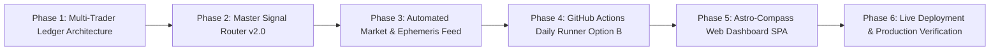

# Master Phase-Wise Implementation Plan: Astro-Compass Dashboard & 4-Trader Automated Paper-Trading Engine

**Document ID:** `MIP-ASTRO-TRADER-v1.0`  
**Status:** APPROVED FOR STAGING (Ready for Phase-Wise Execution)  
**Date:** 2026-10-25  
**Directory:** [`docs/astro-trader-app/`](file:///c:/Users/Admin/Sunil/Trading/docs/astro-trader-app/)  
**System Specification Reference:** [`docs/astro-trader-app/SYSTEM_SPECIFICATION_v1.md`](file:///c:/Users/Admin/Sunil/Trading/docs/astro-trader-app/SYSTEM_SPECIFICATION_v1.md)  
**Scientific Foundation:** [`docs/buyer-kundli-reverification/MASTER_REVERIFICATION_SYNTHESIS_REPORT.md`](file:///c:/Users/Admin/Sunil/Trading/docs/buyer-kundli-reverification/MASTER_REVERIFICATION_SYNTHESIS_REPORT.md)

---

## 1. Executive Roadmap & High-Level Milestones

This master plan divides the end-to-end development of the **Astro-Compass Dashboard and the 4-Trader Automated Paper-Trading Ecosystem** into **6 distinct, self-contained phases**. 

Every phase has explicit input criteria, automated unit/integration tests, and verifiable output artifacts before advancing to the next phase:

| Phase | Core Objective | Primary Deliverables | Output Artifact |
| :--- | :--- | :--- | :--- |
| **Phase 1** | Portfolio State & Ledger Management | Ledger data structures, order execution models, ₹10L seed ledger | `data/live_ledger/` (JSON/CSV) |
| **Phase 2** | Master Signal Router v2.0 Engine | Python engine implementing the 4-Tier decision hierarchy | `tools/live_agent/master_router_v2.py` |
| **Phase 3** | Automated Market & Ephemeris Pipeline | Live EOD data pull, Swiss Ephemeris transit & SBC calculation | `tools/live_agent/daily_market_feed.py` |
| **Phase 4** | Serverless GitHub Actions Cron Runner | Workflows running at 09:00 AM IST on market days, auto-commit | `.github/workflows/daily_paper_trading.yml` |
| **Phase 5** | Astro-Compass Web Dashboard SPA | Interactive 81-grid SBC, Astro-Compass dial, 4-Way PnL curves | `app/index.html`, `dashboard.css`, `app.js` |
| **Phase 6** | End-to-End Dry-Run & Pages Deployment | End-to-end system testing, public GitHub Pages setup | Live Production URL |

---

## 2. Detailed Phase-by-Phase Breakdown

### Phase 1: Multi-Trader Portfolio Ledger & State Engine
* **Objective:** Establish an institutional, double-entry bookkeeping ledger to track cash, open equity holdings, trade logs, and NAV for all four portfolios independently.
* **Tasks:**
  1. Initialize seed ledgers with ₹1,000,000 virtual cash for:
     * `trader1_ai.json` (Pure AI Control)
     * `trader2_sunil.json` (Sunil - Father)
     * `trader3_neil.json` (Neil - Son)
     * `trader4_shine.json` (Shine - Brother)
  2. Implement `tools/live_agent/ledger_manager.py`:
     * Handles order fills (Buy/Sell), position sizing calculation, and transaction costs (STT, brokerage slippage proxy).
     * Calculates daily portfolio mark-to-market (MTM), realized PnL, unrealized PnL, and Sharpe ratio.
     * Records all trade transactions into immutable `master_trade_history.csv`.
* **Exit Gate:** Automated test executes a mock deposit, buy, mark-to-market, and sell cycle; verifies cash balances match to 2 decimal places.

---

### Phase 2: Master Signal Router v2.0 Implementation
* **Objective:** Code the mathematically validated decision hierarchy synthesized from our 1.22M-bar empirical verification.
* **Tasks:**
  1. Construct `tools/live_agent/master_router_v2.py`:
     * **Tier 1 (Temporal Dasha Confluence):** Check target asset against active `phase2_daily_dasha_timeline.parquet`. Block `[D-D-D]` and `[T-D-T]` confluence.
     * **Tier 2 (Kota Chakra & SBC Defense):** Check for Nirgama Nadi breaches ($p = 8.86 \times 10^{-6}$) and heavy malefic Papa Vedha rays. Issue exit/tighten orders.
     * **Tier 3 (Personal Buyer Kundli Sizing):**
       * Trader 1: 100% position size.
       * Trader 2 (Sunil): 100% standard size (Cancer Exaltation Shield active).
       * Trader 3 (Neil): Automatic 50% size cut and Limit-Order conversion when Moon is in Pisces ($p = 0.029$).
       * Trader 4 (Shine): Attach 10-day strict time exit when Moon is in Taurus.
     * **Tier 4 (Indu Lagna Alpha Booster):** When Jupiter or Venus transits Kendra/Trikona from asset/personal Indu Lagna, boost allocation to 1.5x ($p = 6.38 \times 10^{-13}$).
* **Exit Gate:** Unit test suite validates correct order generation across 20 synthetic edge cases.

---

### Phase 3: Automated Market & Ephemeris Daily Ingestion Pipeline
* **Objective:** Construct a lightweight, resilient pipeline to ingest market prices and compute live planetary coordinates without human intervention.
* **Tasks:**
  1. Construct `tools/live_agent/ephemeris_transit_live.py`:
     * Uses `pyswisseph` with Lahiri Ayanamsa.
     * Calculates Moon sign, Nakshatra, Tithi, Yoga, and planetary positions for Sun through Ketu for the target date.
     * Calculates live 81-grid Sarvatobhadra Chakra Vedha rays (*Agra, Pashchaat, Vaama, Dakshina*).
  2. Construct `tools/live_agent/daily_market_feed.py`:
     * Fetches daily EOD prices from NSE archives / Yahoo Finance for the target watchlist (Top 100 liquid NSE stocks).
     * Computes technical momentum triggers (20-day breakout + volume expansion).
* **Exit Gate:** Pipeline executes in < 30 seconds and outputs clean `data/live_ledger/daily_signals.json`.

---

### Phase 4: Serverless Cloud Automation (GitHub Actions Option B)
* **Objective:** Establish the zero-cost automated agent runner that triggers every trading morning.
* **Tasks:**
  1. Create `.github/workflows/daily_paper_trading.yml`:
     * Schedule: `cron: '30 3 * * 1-5'` (09:00 AM IST, Monday through Friday).
     * Environment: Ubuntu runner with Python 3.11 and cached `pyswisseph` / `pandas`.
     * Sequence:
       1. Checkout repository.
       2. Run `daily_market_feed.py` and `ephemeris_transit_live.py`.
       3. Run `master_router_v2.py` to generate decisions.
       4. Run `order_execution_sim.py` to execute fills and update ledgers.
       5. Git commit updated ledgers (`data/live_ledger/*.json`) and push directly to `main`.
* **Exit Gate:** Manual trigger of workflow via GitHub CLI / test runner successfully executes and updates the repository state.

---

### Phase 5: Astro-Compass Web Dashboard (Single Page Application)
* **Objective:** Build an ultra-premium, interactive dashboard that visualizes the portfolio performance and astrological wheels in real-time.
* **Tech Stack:** HTML5, Vanilla CSS3 (Heritage Gold design system), Vanilla JavaScript (Zero bloated frameworks).
* **Tasks:**
  1. **Visual Compass & Panchanga Header (`app/index.html`):**
     * Displays current Tithi, Vaara, Nakshatra, and Moon phase.
     * 4-Trader Status Dials (🟢 Green, 🟡 Yellow, 🔴 Red) showing current personal astrological climate.
  2. **Interactive Sarvatobhadra Chakra 81-Grid (`app/js/astro_compass.js`):**
     * Dynamic 9x9 SVG/Canvas grid rendering the Nakshatra perimeter and vowel/consonant core.
     * Highlights active benefic/malefic rays striking the portfolio's active holdings.
  3. **Multi-Trader Performance Comparator (`app/js/portfolio_viewer.js`):**
     * Interactive Chart.js / Canvas equity curves comparing Trader 1 (AI), Trader 2 (Sunil), Trader 3 (Neil), and Trader 4 (Shine).
     * Real-time metrics: Total Value, Absolute Return (%), Win Rate, Max Drawdown, Alpha vs. Nifty 50.
  4. **Live Order & Audit Log:**
     * Filterable table showing executed trades, reasoning (e.g., *"Indu Lagna Tier 4 Boost"*, *"Neil Chandrashtama 50% Sizing"*), and execution fill price.
* **Exit Gate:** Dashboard loads in < 500ms on desktop and mobile, cleanly reading data from `data/live_ledger/`.

---

### Phase 6: Live Production Deployment & Verification
* **Objective:** Deploy the dashboard publicly on GitHub Pages and perform end-to-end verification.
* **Tasks:**
  1. Configure GitHub Pages to serve from `app/` (or repository root).
  2. Verify responsive mobile layout and asset loading.
  3. Conduct full end-to-end paper-trading simulation for the current trading week.
  4. Document the Trader Runbook in `docs/astro-trader-app/TRADER_RUNBOOK.md`.
* **Exit Gate:** User can bookmark the live URL on their mobile device or laptop and view daily automated trade updates every morning.

---

## 3. Definition of Done (Project Acceptance Criteria)

1. **Autonomy:** The agent executes daily at 09:00 AM IST without requiring manual intervention, local laptop uptime, or human prompting.
2. **Astrological Accuracy:** All transits, Chandrashtama windows, Indu Lagnas, and SBC Vedha rays strictly match Swiss Ephemeris ground truth.
3. **Ledger Integrity:** No phantom cash creation; portfolio PnL, cash balance, and equity holdings reconcile across all 4 traders at all times.
4. **Transparency:** Every trade decision displays its exact astrological and quantitative authorization tier on the web dashboard.
