# Master Implementation Plan: Market Learning App

**Document ID:** `MIP-MARKET-LEARN-v4.1`  
**Status:** Stage 1 built 2026-10-26; owner device checks pending  
**Date:** 2026-10-26  
**Directory:** [`docs/astro-trader-app/`](./)  
**System Specification:** [`SYSTEM_SPECIFICATION_v1.md`](SYSTEM_SPECIFICATION_v1.md) (SSD v4.1)  
**User-facing description:** [`APP_FUNCTIONALITY.md`](APP_FUNCTIONALITY.md)  
**Decision:** D42 in [`docs/DECISIONS.md`](../DECISIONS.md)

> **Change from v4.0:** the plan now builds on the existing workspace (`packages/core`, `packages/data-service`, `packages/app`) instead of a new Capacitor/Electron app. Section 3 maps what already exists against every stage. Stage numbering and releases are unchanged; most stages are smaller.

---

## 1. Decisions Already Made

| Topic | Decision |
| :--- | :--- |
| Goal | Single place to learn about the Indian market, for a complete beginner |
| Codebase | The existing pnpm workspace; the Expo app in `packages/app` (D42) |
| Platforms | Android APK (Expo build, sideloaded) and the web app on the Windows laptop with the local data helper |
| Data sharing between devices | None automatic; per-profile Export / Import (extends the existing signed bundle) |
| Astrology | Removed from the app; research packages untouched |
| Instrument order | Stocks, ETFs, mutual funds; then futures and options; then currency, commodities (partial), bonds (calculator) |
| Lesson content | Cut from the four Investor Guides; Claude drafts, Sunil reviews; draft until reviewed |
| Robo accounts (v3.0 engine) | Kept; run on the device by catch-up when the app opens |
| AI tutor | Off / Preview / On, per-feature switches; **Preview at install**; Claude (Haiku 5.5 default, Opus 5.5 for deep reviews) or a free-tier provider; ₹200 monthly limit default; runbook R15–R17 revised as in SSD §7.6 |

---

## 2. Roadmap

```mermaid
graph LR
    S0[0: Prototype astrology removed - done] --> S1[1: Foundation on the existing app]
    S1 --> S2[2: Real market data on both devices]
    S2 --> S3[3: Engine extensions - order types, ETF, MF]
    S3 --> S4[4: Learn, coach, journal]
    S4 --> S5[5: AI tutor]
    S5 --> S6[6: Time Machine & Scenarios]
    S6 --> R1((Release 1))
    R1 --> S7[7: Charts, Strategy Lab, Robo accounts]
    S7 --> S8[8: Futures & Options]
    S8 --> R2((Release 2))
    R2 --> S9[9: Other markets, tax, psychology]
    S9 --> S10[10: Final verification]
    S10 --> R3((Release 3))
```

| Stage | Delivers | Size v4.0 → v4.1 | Lessons added |
| :--- | :--- | :--- | :--- |
| **0** | Python/HTML prototype de-astrologised | Done (`fcea9fd`) | — |
| **1** | Existing app without astro; profiles, PIN, settings; new navigation; SQLite and secure store on Android; per-profile export/import; first debug APK | L → **M** | — |
| **2** | Real prices instead of demo data: device downloader on the phone, data helper on the laptop, table store, bundled history | L → **M** | — |
| **3** | SL, SL-M, GTT; ETF and mutual fund kinds; contract notes; facts file; desk screens extended | L → **M** | — |
| **4** | Lesson engine, glossary, quizzes, path, progress, coach, mistake checker, journal | L → **L** | Levels 1–2 (from Guides 1, 2, 4) |
| **5** | `packages/tutor`, providers, Preview samples, features, limits | M → M | — |
| **6** | Time Machine on the replay module, Scenarios, Portfolio Builder | M → **S–M** | — |
| **R1** | **First release APK and laptop setup** | — | — |
| **7** | Candle charts and indicators, Strategy Lab, backtester, Robo accounts | M → M | Level 3 |
| **8** | Futures and options end to end, Options Lab | XL → XL | Level 4 (from Guide 3) |
| **R2** | **Second release** | — | — |
| **9** | Currency, commodities (partial), bond calculator, tax report, psychology tools | L → L | Levels 5–6 |
| **10** | Final verification, content sign-off, user guide | M → M | — |
| **R3** | **Complete release** | — | — |

Sizes as in the existing plan: S ≈ 1 week, M ≈ 2–3 weeks, L ≈ 4–6 weeks, for one part-time developer.

---

## 3. What Already Exists (mapping against v4.0)

Baseline on 2026-10-26: `pnpm test` passes **1,039 tests in 104 files**. UAT rounds 1 and 2 signed off by the owner.

| v4.1 need | Existing piece | Reuse | Gap |
| :--- | :--- | :--- | :--- |
| App shell, offline views, phone layout | `packages/app` (Expo universal, tabs, `useOnline`, read-through cache; WP-3.1, 3.7 accepted) | Keep | New navigation; Android build never made |
| Storage | `KeyValueStore` seam, `IndexedDbKv`, `MemoryKv` | Keep | Android SQLite adapter; table store for history (Stage 2); profile namespacing |
| Export / import | Signed bundle (`core/bundle`), `backupService`, device key, weekly reminder (WP-3.6 accepted) | Keep | Per-profile contents; preview and confirm; journal, lessons, AI usage later |
| Profiles | Only the astro birth profile | Remove | Multi-user profiles, PIN, device owner |
| Settings | Layer switch only (`settings/layer`) | Remove | Settings screen and store |
| Trading desk | Trade, Ledger, Universe, Compare, Report screens; `PaperSession`; cost preview; lots popup (WP-3.2–3.5 accepted) | Keep | Runs on demo data; SL/SL-M/GTT; ETF, MF |
| Engine | `core`: money, fills (circuits, exits), costs (dated schedule), calendar, corporate actions, ledger (FIFO, reconcile), risk, analytics, replay, execution adapter | Keep | Order types, instrument kinds, multiple accounts, F&O (Stage 8) |
| Market data | `data-service`: bhavcopy (back to 1994), Yahoo, AMFI, index closes, actions, status, canonical series, cross-check, HTTP service | Keep | Phone path (pure-JS inflate, RN fetch); MF route; F&O and currency files |
| Charges facts | `core/costs/schedule.ts`, dated, sourced from `docs/data-sources/…csv` | Keep | Facts file for tax, F&O, margins, MF cut-offs |
| Lesson material | Investor Guides 1–4, Stock Market Data Learning Guide (~2,000 lines) | Source | Cut into lessons; quizzes; "Try it"; review |
| Time Machine base | `core/replay` (replay snapshot, deterministic run, Ledger B) | Keep | Day-by-day stepping UI, sessions |
| Performance and "what if held" | `core/analytics` (win/loss, trade metrics, comparators, bootstrap) | Keep | CAGR, drawdown, Sharpe views |
| Mistake checker inputs | `core/risk` limits and checks | Partly | Journal-based and behavioural checks |
| Robo strategy | v3.0 rules (docs only) | Port | Strategy engine in TypeScript (Stage 7) |
| AI | Runbook R15–R17 (rules only); no code | Revise rules | `packages/tutor` (Stage 5) |
| Android rules | `TRADING_APP_RUNBOOK.md` R1–R17, release gate | Keep | First build (Stage 1), allowlist file |
| Browser checks | `tools/e2e/*` (airplane mode, orders, backup, universe, phone, no-astro, lots, profile) | Keep most | `profile.ts` replaced; no-astro check becomes "no astro in the app at all" |
| Astro layer | `packages/app/src/astro`, entitlement gate, `@trading/astro-engine` dependency, Profile tab, Malayalam/Hindi astro text | **Remove from app** | — |
| Signed daily snapshot | `snapshotClient`, Data tab section, D26 host | **Remove from app** (stays for research) | — |
| Python/HTML prototype | `tools/live_agent`, `app/`, `data/live_ledger`, `daily_paper_trading.yml` | **Delete** | — |

**Effect on open UAT work:** UAT-3 and UAT-4 (astro profile, Malayalam/Hindi, lots popup) and UAT-5 (daily snapshot, H-21 report) belong to the research app. With D42 the astro and snapshot cases no longer apply to the learning app; the lots-popup cases are re-run in Stage 1's check. The research work (H-21, PH entries) continues separately under the existing plan v1.2.

---

## 4. Stage Details

### Stage 1: Foundation on the Existing App (for approval)

**Goal:** the existing app becomes the learning app's shell, without astrology, with family profiles and settings, running on the laptop browser and as a debug APK on an Android phone, and moving a profile between them by export and import.

| # | Task | Files / packages | Done when |
| :--- | :--- | :--- | :--- |
| 1.1 | **Remove the astro layer from the app:** `src/astro/*`, `entitlement/*`, Profile tab, layer switch, ShieldsSection; drop the `@trading/astro-engine` dependency from `@trading/app` | `packages/app` | App builds with no import of astro-engine (dependency-cruiser rule added); no-astro e2e passes with no switch at all |
| 1.2 | **Remove the snapshot section from the app** (Data tab keeps data-helper status only) | `packages/app/src/snapshotClient`, `screens/SnapshotSection.tsx`, `DataScreen.tsx` | No request to port 8788 from the app (airplane/allowlist check) |
| 1.3 | **Delete the Python/HTML prototype** and its workflow | `tools/live_agent`, `app/`, `data/live_ledger`, `.github/workflows/daily_paper_trading.yml` | Folders gone; nothing references them |
| 1.4 | **Profiles:** create, rename, delete, switch; optional PIN (salted SHA-256 via core hash); device owner; profile-namespaced keys (`p/<id>/…`); move existing data into "Owner" on first run | `packages/app/src/profiles` (new), `store/kv.ts` | Two profiles keep separate orders; existing paper orders appear under "Owner" after upgrade (migration test) |
| 1.5 | **Settings:** per-profile and device-wide settings with defaults (AI mode `preview`, monthly limit, mistake-checker thresholds, display); settings screen | `packages/app/src/settings` (new), `screens/SettingsScreen.tsx` | Settings survive restart on web and Android |
| 1.6 | **New navigation:** Home, Learn, Practise, Measure, Tutor, Settings. Practise holds the existing Trade, Ledger, Universe, Compare, Report; Settings holds Profiles, Backup, Data; Learn, Measure and Tutor are placeholders that say what is coming; first-launch disclaimer | `packages/app/src/App.tsx`, `screens/*` | All existing screens reachable; phone-width check passes |
| 1.7 | **Android storage:** `SqliteKv` implementing `KeyValueStore` with `expo-sqlite`; platform selection (IndexedDB on web, SQLite on Android) | `packages/app/src/store/sqliteKv.ts` | Same KV contract tests pass for memory, IndexedDB and SQLite |
| 1.8 | **Secure store seam:** interface with `expo-secure-store` on Android and WebCrypto-wrapped IndexedDB on web; used for PIN hashes now, API keys in Stage 5 | `packages/app/src/secure` (new) | Values unreadable in plain storage; delete removes them |
| 1.9 | **Per-profile export/import:** extend the signed bundle with profile and settings; preview of what will change, then confirm; never includes PINs or secure-store values; old bundles import into "Owner" | `core/bundle`, `app/backup` | Round-trip test; old-format bundle test; export on web → import on Android gives identical profile |
| 1.10 | **Native platform pieces:** secure random on Android (`expo-crypto`) for the device key; file save and share on Android (`expo-file-system`, `expo-sharing`); file pick for import (`expo-document-picker`) | `app/backup/platform.ts` | Export and import work on the phone without a browser |
| 1.11 | **First Android build:** build profiles per runbook R1 (`preview` = sideload APK, `arm64-v8a`), SDK levels single-sourced (R2), cold-start safety (R4), cleartext off (R5); local Gradle build on the laptop | `packages/app/app.config.*`, `eas.json` or build script | Debug/preview APK installs and opens on the owner's phone; cold start under 3 s |
| 1.12 | **Network allowlist file** listing today's hosts (data helper on 127.0.0.1; NSE, Yahoo, AMFI for Stage 2) | `docs/network-allowlist.md` (new) | Exists; referenced by the airplane check |
| 1.13 | **CI workflow:** `pnpm verify`, web export, Android preview APK as a build artifact | `.github/workflows/app.yml` (new) | Green run on GitHub with the APK attached |
| 1.14 | **Records:** D42 logged; this plan's Stage 1 marked done with results | `docs/DECISIONS.md`, this file | Updated in the same change as the work |

**Out of Stage 1:** real market data (Stage 2: the app still trades on the core demo data), lessons, AI, new order types.

**Exit gate (all must pass):**
1. `pnpm verify` passes: all existing tests (1,039 baseline, minus removed astro-app tests) plus the new ones.
2. Browser checks pass on the web export: airplane mode, order entry, backup, universe, phone width, lots popup, and the no-astro check with no switch available.
3. The preview APK installs on the owner's phone; the same tabs appear as on the web.
4. Two profiles on one device keep separate orders and settings; PIN prompts work.
5. A profile exported on the laptop and imported on the phone shows identical orders, positions and settings; no PIN or key is in the file.
6. An existing bundle exported from the current app imports into "Owner".
7. No outbound request other than those in the allowlist (airplane and host checks).

**Owner actions in Stage 1:** install the APK on your phone (allow "install unknown apps"); run the exit-gate checks 3–5 on your devices; approve D42.

#### Stage 1 result (2026-10-26, built by the assistant; owner checks pending)

| Exit gate | Result |
| :--- | :--- |
| 1. Checks | Type check, size caps (0 errors), dependency rules (incl. new `app-no-astro`) and **986 tests** pass. Lint passes for `packages/` and the test tools; the research scripts at the top of `tools/` (Phase 1 universe scripts, `tools/dasha-collapse/`) already failed lint before Stage 1 and still do, so `pnpm verify` as a whole stops at lint. CI lints the packages and test tools only until those scripts are fixed |
| 2. Browser checks on the web export | All pass: airplane mode 9, order entry 14, backup (incl. restore onto a cleared browser), universe 9, lots popup 17, phone width 166 (360 and 320 px, every screen), no-astro 37 |
| 4. Two profiles, PIN | New browser check `tools/e2e/profiles.ts` passes (12 checks): separate books, PIN asked after reload, wrong PIN refused, PIN screen opens another profile; unit tests cover ids, owner hand-over, delete and migration |
| 6. Old bundle imports into "Owner" | Unit test passes |
| 7. No outbound request outside the allowlist | No-astro check: no request leaves the machine; `docs/network-allowlist.md` created |
| 3. Preview APK | Built locally on the laptop and kept at `packages/app/build-apk/market-learning-0.1.0-preview-arm64.apk` (git-ignored), about 25 MB (budget 150 MB), arm64-v8a only, compile API 37 / target API 36 / min API 24, cleartext off, permissions: internet (plus vibrate from React Native). Signed with the standard debug key (a preview; the owner's release keystore comes at Release 1). **Installing on the owner's phone and the cold-start check: owner to run** |
| Emulator smoke test (assistant) | The arm64 APK installs on the laptop's x86_64 emulator but cannot load its native libraries there (expected: no x86_64 libraries in an arm64 build). A separate x86_64 test build ran on the emulator (Android 15 image): first start made the "Owner" profile in SQLite, the note and Home screen showed, an order placed under Practise was still there after a full restart (cash ₹9,89,030.43, one position), no crash in the log. Not a substitute for the real-phone check |
| 5. Laptop → phone transfer | **Owner to run** |

Build notes (Windows laptop): the Android SDK's default CMake 3.22.1 loops on "build.ninja still dirty" for `expo-modules-core`; CMake 3.31.6 (installed through the SDK manager, chosen in the generated `android/local.properties`) builds it. The Expo SDK 58 libraries need compile API 37, recorded in `docs/sdk-levels.json`. CI builds on Linux and has not run yet (it runs on the first push).

Changes beyond the task table: the app's snapshot client moved to `packages/workers/src/snapshotClient` (research keeps its end-to-end test); restoring a backup onto a device whose only profile is the empty starting one replaces that profile (found by the backup check); `docs/sdk-levels.json`, `docs/size-budget.json` and `docs/native-deps.md` record runbook R2–R4.

---

### Stage 2: Real Market Data on Both Devices

#### Stage 2a (laptop slice), built 2026-10-26 at the owner's request during UAT-6
* The owner's list of 50 stocks (`data/market/learning_symbols.txt`; TATAMTR replaced by TATAMOTORS, which is now TMPV, plus TMCV after the October 2025 demerger: 51) is built from the NSE bhavcopy archive already on the laptop by `pnpm market:build` into `data/derived/market/learning-market-v1.json` (git-ignored, about 8 MB): prices 2011-06-22 to 2026-10-16, 926 corporate actions, renames followed by ISIN. Stocks that stopped trading keep their history (Jet Airways to 2024-11-07, Punj Lloyd to 2022-10-06); Gitanjali (2019) and DCHL (2013) end before the charges table starts on 2020-04-01, so they can be viewed but not traded.
* `packages/core/src/market`: the market file format (compact bars) and its decoding into the replay snapshot. The data helper serves it on `/market`; `pnpm uat:start` loads it.
* App: a Demo / Real NSE switch at the top of Practise, one book per market per profile (the demo book keeps its key), a searchable stock picker, symbols in the book, the real market saved on the device for offline use, and backups that carry every book.
* Checks: 997 tests; all earlier browser checks; new `pnpm e2e:market` (6 checks).
* **Stage 2b (built 2026-10-26):**
  * *Bundled history:* `pnpm market:bundle` puts the stock prices (about 8 MB, 2.8 MB in the APK) and the fund NAVs inside the app; a new install has real prices offline. The loader keeps the newest of: saved copy, bundled file, data helper.
  * *Daily catch-up on the phone:* on Android, with no helper, the app reads NSE's daily file for each weekday after its saved prices end (pure-JS unzip with `fflate`), matches stocks by ISIN, skips holidays (no file), keeps what was fetched if the network fails, at most 45 days per open. **Not yet tried against NSE from a real phone**: if NSE refuses the request the app simply stays on the bundled prices. Corporate actions after the build date are not applied.
  * *Mutual funds:* 12 direct-growth funds (index, flexi, large, small, balanced, bond, liquid, gold; `data/market/learning_funds.txt`) built by `pnpm funds:build` from the free mfapi.in mirror of AMFI, each latest NAV checked against AMFI's own file (none disputed); NAVs from 2013 are stored as integer ten-thousandths of a rupee; served by the helper on `/funds`, bundled in the app; Settings → Data shows what prices the device holds. The funds cannot be traded until Stage 3.
  * *Checks:* 989 tests in packages and tools; `pnpm e2e:market` has 8 checks (new install with no helper has real prices; Data screen lists stocks and funds).
* **Still to do from Stage 2:** the fund catch-up on the phone, a mutual-fund route that refreshes from AMFI itself, ETFs, indices from 2015, a cross-check against a second price source, and the timing exit gate (a missed week catching up in under 30 s on a real phone). These need the real-phone check first.
* **Reuse:** data-service parsers, canonicalisation, cross-check, index puller, actions, status, HTTP service.
* **Tasks:** pure-JS inflate in the shared zip path; React Native HTTP client implementing the existing `HttpClient`; device downloader with rate limiting and retry (existing); MF NAV route on the data helper; table store for daily bars (SQLite on Android, IndexedDB on web); bundled history build job in `workers` (universe, main ETFs and indices from 2015, selected funds); catch-up of missing sessions on app open; the Practice account switches from demo data to real data; data health view.
* **Exit gate:** fresh install loads bundled history offline; a missed week catches up in under 30 s on Wi-Fi on the phone and via the helper on the laptop; cross-check passes; holidays skipped; no host outside the allowlist.

### Stage 3: Engine Extensions (Stocks, ETFs, Mutual Funds)
* **Reuse:** fills, costs schedule, ledger, corporate actions, execution adapter, cost preview, order text.
* **Tasks:** order types SL, SL-M, GTT; instrument kinds ETF and mutual fund (lump sum, SIP, redemption, cut-off); refusal reasons extended; contract note view; facts file in `packages/content` referencing the cost schedule; desk screens for the new orders and kinds; multiple accounts per profile (Practice, Time Machine sessions, Robo accounts).
* **Exit gate:** at least 40 new hand-worked tests (each order type, gap through stop, partial cash, SIP on a holiday, MF cut-off, split); no-look-ahead test; ledger reconcile catches a broken book; all earlier tests still pass.

### Stage 4: Learn, Built-in Coach and Journal
* **Tasks:** `packages/content` with lesson Markdown and front matter; lesson renderer with "facts as of"; glossary (from the guides' glossaries); quiz engine (from the self-check sections); learning path and progress; journal prompts; mistake checker (SSD §6.2) using `core/risk` where it fits; coach hints; **Level 1–2 lessons cut from Investor Guides 1, 2 and 4**, reviewed by Sunil.
* **Exit gate:** a new profile completes Level 1 without AI; every Level 1–2 lesson reviewed; each mistake rule has a test.

### Stage 5: AI Tutor
* **Tasks:** `packages/tutor` (no DOM/Node imports; boundary rule that core and the order path cannot import it); Claude provider with the official SDK (Haiku 5.5 default; Sonnet and Opus per feature); free-tier provider after re-checking terms; context builders per feature; verifier per SSD §7.6 (advice phrases, unknown tickers, account figures from context only); stored answers with provenance; Preview samples; settings, limit and usage meter; allowlist entries; runbook R15–R17 updated to match SSD §7.6.
* **Exit gate:** Preview works offline; each feature answers with the right context; limit stops at the cap; bad key or no network shows the coach answer; "give me a stock tip" prompts declined; AI-off and AI-on runs give identical accounts (hash compare).

### Stage 6: Time Machine, Scenarios, Portfolio Builder
* **Reuse:** `core/replay`, analytics comparators.
* **Tasks:** Time Machine sessions with day/week stepping, save and resume, end summary; scenario format and first 6 scenarios (stocks, ETFs, funds); Portfolio Builder; AI scenario debrief.
* **Exit gate:** a 2020 session plays end to end with correct fills and no future data visible (test); 6 scenarios complete with debriefs.

### Release 1
* Release APK signed with the owner's keystore (backed up in two places), runbook release gate (§12), laptop setup command and desktop shortcut, install notes. Family use and feedback before Stage 7.

### Stage 7: Charts, Strategy Lab, Robo Accounts
* **Tasks:** candle charts with moving averages, RSI and volume; strategy engine (port of v3.0 rules) and backtester on the same engine; Strategy Lab screen; five Robo accounts with catch-up; Level 3 lessons (Guides 2 and 4), reviewed.
* **Exit gate:** at least 25 strategy tests (slots, cash, gaps, missing prices, time exits, cool-off); no-look-ahead test for backtests and catch-up; a missed fortnight processes correctly.

### Stage 8: Futures and Options
* **Tasks:** NSE F&O file parser and downloader; contract master and lot sizes from the exchange file; futures margin (approximate, facts file), MTM, expiry, rollover; options buying and writing, premium flows, margin, expiry; IV and Greeks; option chain; F&O ticket; Options Lab; F&O scenarios (at least 4) and mistake rules; Level 4 lessons from Guide 3, reviewed.
* **Exit gate:** hand-worked margin, MTM, expiry and payoff tests; Greeks within tolerance of a reference; F&O scenarios complete.

### Release 2
* Release with F&O; backups from Release 1 import correctly.

### Stage 9: Other Markets, Tax, Psychology
* **Tasks:** currency derivatives; commodities (simplified, if data is usable); bond calculator; tax report per financial year; journal emotion tags and weekly reflection; Level 5–6 lessons (Guides 1, 2, 4), reviewed.
* **Exit gate:** tax report matches hand-worked examples; currency trades pass the engine tests; Levels 5–6 reviewed.

### Stage 10: Final Verification
* Every SSD §13 item on a real phone and on the laptop; facts file as-of dates checked; in-app user guide and `USER_GUIDE.md`; verification report.

### Release 3
* Complete release. A hosted version for sharing is a separate later project.

---

## 5. Content Workflow (all stages)

1. Claude cuts a lesson from the Investor Guides (or drafts it new), with quiz and "Try it" exercise, using the facts file for changeable rules.
2. Committed as `draft`; the app shows "Draft".
3. Sunil reads it in the app and notes changes; Claude revises.
4. When accepted: `reviewed`, with reviewer and date.
5. When a fact changes, every lesson using it is listed for re-review.

---

## 6. Risks and Mitigations

| Risk | Mitigation |
| :--- | :--- |
| Removing the astro layer breaks accepted app behaviour | Remove in one step with the existing browser checks re-run; the research packages are not touched |
| First Android build hits native issues (Expo SDK 58, New Architecture) | Stage 1 builds the APK early, before any new feature depends on it; runbook R1–R4 |
| NSE blocks automated downloads from a phone | Existing rate limiter and retry, browser-like headers, Yahoo fallback, bundled history |
| Web storage cleared by the browser on the laptop | Existing persistence request and weekly export reminder |
| Facts go out of date | Dated cost schedule and facts file; re-review list; lot sizes from exchange files |
| AI cost overrun | Device-wide rupee limit, cost estimate before each call, Haiku default |
| Free-tier terms change | Re-checked at Stage 5 and shown in the app; can be switched off |
| Losing the APK signing key | Keystore backed up in two places |
| Data licence if shared later | Condition recorded before any sharing project (cf. D32) |
