# Master Implementation Plan: Market Learning App

**Document ID:** `MIP-MARKET-LEARN-v4.1`  
**Status:** Stage 1 built 2026-10-26; owner device checks pending  
**Date:** 2026-10-26  
**Directory:** [`docs/astro-trader-app/`](./)  
**System Specification:** [`SYSTEM_SPECIFICATION_v1.md`](SYSTEM_SPECIFICATION_v1.md) (SSD v4.1)  
**User-facing description:** [`APP_FUNCTIONALITY.md`](APP_FUNCTIONALITY.md)  
**Decision:** D42 in [`docs/DECISIONS.md`](../DECISIONS.md)

> **Change from v4.0:** the plan now builds on the existing workspace (`packages/core`, `packages/data-service`, `packages/app`) instead of a new Capacitor/Electron app. Section 3 maps what already exists against every stage. Stage numbering and releases are unchanged; most stages are smaller.

---

## 1. Decisions Already Made

| Topic | Decision |
| :--- | :--- |
| Goal | Single place to learn about the Indian market, for a complete beginner |
| Codebase | The existing pnpm workspace; the Expo app in `packages/app` (D42) |
| Platforms | Android APK (Expo build, sideloaded) and the web app on the Windows laptop with the local data helper |
| Data sharing between devices | None automatic; per-profile Export / Import (extends the existing signed bundle) |
| Astrology | Removed from the app; research packages untouched |
| Instrument order | Stocks, ETFs, mutual funds; then futures and options; then currency, commodities (partial), bonds (calculator) |
| Lesson content | Cut from the four Investor Guides; Claude drafts, Sunil reviews; draft until reviewed |
| Robo accounts (v3.0 engine) | Kept; run on the device by catch-up when the app opens |
| AI tutor | Off / Preview / On, per-feature switches; **Preview at install**; Claude (Haiku 5.5 default, Opus 5.5 for deep reviews) or a free-tier provider; ₹200 monthly limit default; runbook R15–R17 revised as in SSD §7.6 |

---

## 2. Roadmap

```mermaid
graph LR
    S0[0: Prototype astrology removed - done] --> S1[1: Foundation on the existing app]
    S1 --> S2[2: Real market data on both devices]
    S2 --> S3[3: Engine extensions - order types, ETF, MF]
    S3 --> S4[4: Learn, coach, journal]
    S4 --> S5[5: AI tutor]
    S5 --> S6[6: Time Machine & Scenarios]
    S6 --> R1((Release 1))
    R1 --> S7[7: Charts, Strategy Lab, Robo accounts]
    S7 --> S8[8: Futures & Options]
    S8 --> R2((Release 2))
    R2 --> S9[9: Other markets, tax, psychology]
    S9 --> S10[10: Final verification]
    S10 --> R3((Release 3))
```

| Stage | Delivers | Size v4.0 → v4.1 | Lessons added |
| :--- | :--- | :--- | :--- |
| **0** | Python/HTML prototype de-astrologised | Done (`fcea9fd`) | — |
| **1** | Existing app without astro; profiles, PIN, settings; new navigation; SQLite and secure store on Android; per-profile export/import; first debug APK | L → **M** | — |
| **2** | Real prices instead of demo data: device downloader on the phone, data helper on the laptop, table store, bundled history | L → **M** | — |
| **3** | SL, SL-M, GTT; ETF and mutual fund kinds; contract notes; facts file; desk screens extended | L → **M** | — |
| **4** | Lesson engine, glossary, quizzes, path, progress, coach, mistake checker, journal | L → **L** | Levels 1–2 (from Guides 1, 2, 4) |
| **5** | `packages/tutor`, providers, Preview samples, features, limits | M → M | — |
| **6** | Time Machine on the replay module, Scenarios, Portfolio Builder | M → **S–M** | — |
| **R1** | **First release APK and laptop setup** | — | — |
| **7** | Candle charts and indicators, Strategy Lab, backtester, Robo accounts | M → M | Level 3 |
| **8** | Futures and options end to end, Options Lab | XL → XL | Level 4 (from Guide 3) |
| **R2** | **Second release** | — | — |
| **9** | Currency, commodities (partial), bond calculator, tax report, psychology tools | L → L | Levels 5–6 |
| **10** | Final verification, content sign-off, user guide | M → M | — |
| **R3** | **Complete release** | — | — |

Sizes as in the existing plan: S ≈ 1 week, M ≈ 2–3 weeks, L ≈ 4–6 weeks, for one part-time developer.

---

## 3. What Already Exists (mapping against v4.0)

Baseline on 2026-10-26: `pnpm test` passes **1,039 tests in 104 files**. UAT rounds 1 and 2 signed off by the owner.

| v4.1 need | Existing piece | Reuse | Gap |
| :--- | :--- | :--- | :--- |
| App shell, offline views, phone layout | `packages/app` (Expo universal, tabs, `useOnline`, read-through cache; WP-3.1, 3.7 accepted) | Keep | New navigation; Android build never made |
| Storage | `KeyValueStore` seam, `IndexedDbKv`, `MemoryKv` | Keep | Android SQLite adapter; table store for history (Stage 2); profile namespacing |
| Export / import | Signed bundle (`core/bundle`), `backupService`, device key, weekly reminder (WP-3.6 accepted) | Keep | Per-profile contents; preview and confirm; journal, lessons, AI usage later |
| Profiles | Only the astro birth profile | Remove | Multi-user profiles, PIN, device owner |
| Settings | Layer switch only (`settings/layer`) | Remove | Settings screen and store |
| Trading desk | Trade, Ledger, Universe, Compare, Report screens; `PaperSession`; cost preview; lots popup (WP-3.2–3.5 accepted) | Keep | Runs on demo data; SL/SL-M/GTT; ETF, MF |
| Engine | `core`: money, fills (circuits, exits), costs (dated schedule), calendar, corporate actions, ledger (FIFO, reconcile), risk, analytics, replay, execution adapter | Keep | Order types, instrument kinds, multiple accounts, F&O (Stage 8) |
| Market data | `data-service`: bhavcopy (back to 1994), Yahoo, AMFI, index closes, actions, status, canonical series, cross-check, HTTP service | Keep | Phone path (pure-JS inflate, RN fetch); MF route; F&O and currency files |
| Charges facts | `core/costs/schedule.ts`, dated, sourced from `docs/data-sources/…csv` | Keep | Facts file for tax, F&O, margins, MF cut-offs |
| Lesson material | Investor Guides 1–4, Stock Market Data Learning Guide (~2,000 lines) | Source | Cut into lessons; quizzes; "Try it"; review |
| Time Machine base | `core/replay` (replay snapshot, deterministic run, Ledger B) | Keep | Day-by-day stepping UI, sessions |
| Performance and "what if held" | `core/analytics` (win/loss, trade metrics, comparators, bootstrap) | Keep | CAGR, drawdown, Sharpe views |
| Mistake checker inputs | `core/risk` limits and checks | Partly | Journal-based and behavioural checks |
| Robo strategy | v3.0 rules (docs only) | Port | Strategy engine in TypeScript (Stage 7) |
| AI | Runbook R15–R17 (rules only); no code | Revise rules | `packages/tutor` (Stage 5) |
| Android rules | `TRADING_APP_RUNBOOK.md` R1–R17, release gate | Keep | First build (Stage 1), allowlist file |
| Browser checks | `tools/e2e/*` (airplane mode, orders, backup, universe, phone, no-astro, lots, profile) | Keep most | `profile.ts` replaced; no-astro check becomes "no astro in the app at all" |
| Astro layer | `packages/app/src/astro`, entitlement gate, `@trading/astro-engine` dependency, Profile tab, Malayalam/Hindi astro text | **Remove from app** | — |
| Signed daily snapshot | `snapshotClient`, Data tab section, D26 host | **Remove from app** (stays for research) | — |
| Python/HTML prototype | `tools/live_agent`, `app/`, `data/live_ledger`, `daily_paper_trading.yml` | **Delete** | — |

**Effect on open UAT work:** UAT-3 and UAT-4 (astro profile, Malayalam/Hindi, lots popup) and UAT-5 (daily snapshot, H-21 report) belong to the research app. With D42 the astro and snapshot cases no longer apply to the learning app; the lots-popup cases are re-run in Stage 1's check. The research work (H-21, PH entries) continues separately under the existing plan v1.2.

---

## 4. Stage Details

### Stage 1: Foundation on the Existing App (for approval)

**Goal:** the existing app becomes the learning app's shell, without astrology, with family profiles and settings, running on the laptop browser and as a debug APK on an Android phone, and moving a profile between them by export and import.

| # | Task | Files / packages | Done when |
| :--- | :--- | :--- | :--- |
| 1.1 | **Remove the astro layer from the app:** `src/astro/*`, `entitlement/*`, Profile tab, layer switch, ShieldsSection; drop the `@trading/astro-engine` dependency from `@trading/app` | `packages/app` | App builds with no import of astro-engine (dependency-cruiser rule added); no-astro e2e passes with no switch at all |
| 1.2 | **Remove the snapshot section from the app** (Data tab keeps data-helper status only) | `packages/app/src/snapshotClient`, `screens/SnapshotSection.tsx`, `DataScreen.tsx` | No request to port 8788 from the app (airplane/allowlist check) |
| 1.3 | **Delete the Python/HTML prototype** and its workflow | `tools/live_agent`, `app/`, `data/live_ledger`, `.github/workflows/daily_paper_trading.yml` | Folders gone; nothing references them |
| 1.4 | **Profiles:** create, rename, delete, switch; optional PIN (salted SHA-256 via core hash); device owner; profile-namespaced keys (`p/<id>/…`); move existing data into "Owner" on first run | `packages/app/src/profiles` (new), `store/kv.ts` | Two profiles keep separate orders; existing paper orders appear under "Owner" after upgrade (migration test) |
| 1.5 | **Settings:** per-profile and device-wide settings with defaults (AI mode `preview`, monthly limit, mistake-checker thresholds, display); settings screen | `packages/app/src/settings` (new), `screens/SettingsScreen.tsx` | Settings survive restart on web and Android |
| 1.6 | **New navigation:** Home, Learn, Practise, Measure, Tutor, Settings. Practise holds the existing Trade, Ledger, Universe, Compare, Report; Settings holds Profiles, Backup, Data; Learn, Measure and Tutor are placeholders that say what is coming; first-launch disclaimer | `packages/app/src/App.tsx`, `screens/*` | All existing screens reachable; phone-width check passes |
| 1.7 | **Android storage:** `SqliteKv` implementing `KeyValueStore` with `expo-sqlite`; platform selection (IndexedDB on web, SQLite on Android) | `packages/app/src/store/sqliteKv.ts` | Same KV contract tests pass for memory, IndexedDB and SQLite |
| 1.8 | **Secure store seam:** interface with `expo-secure-store` on Android and WebCrypto-wrapped IndexedDB on web; used for PIN hashes now, API keys in Stage 5 | `packages/app/src/secure` (new) | Values unreadable in plain storage; delete removes them |
| 1.9 | **Per-profile export/import:** extend the signed bundle with profile and settings; preview of what will change, then confirm; never includes PINs or secure-store values; old bundles import into "Owner" | `core/bundle`, `app/backup` | Round-trip test; old-format bundle test; export on web → import on Android gives identical profile |
| 1.10 | **Native platform pieces:** secure random on Android (`expo-crypto`) for the device key; file save and share on Android (`expo-file-system`, `expo-sharing`); file pick for import (`expo-document-picker`) | `app/backup/platform.ts` | Export and import work on the phone without a browser |
| 1.11 | **First Android build:** build profiles per runbook R1 (`preview` = sideload APK, `arm64-v8a`), SDK levels single-sourced (R2), cold-start safety (R4), cleartext off (R5); local Gradle build on the laptop | `packages/app/app.config.*`, `eas.json` or build script | Debug/preview APK installs and opens on the owner's phone; cold start under 3 s |
| 1.12 | **Network allowlist file** listing today's hosts (data helper on 127.0.0.1; NSE, Yahoo, AMFI for Stage 2) | `docs/network-allowlist.md` (new) | Exists; referenced by the airplane check |
| 1.13 | **CI workflow:** `pnpm verify`, web export, Android preview APK as a build artifact | `.github/workflows/app.yml` (new) | Green run on GitHub with the APK attached |
| 1.14 | **Records:** D42 logged; this plan's Stage 1 marked done with results | `docs/DECISIONS.md`, this file | Updated in the same change as the work |

**Out of Stage 1:** real market data (Stage 2: the app still trades on the core demo data), lessons, AI, new order types.

**Exit gate (all must pass):**
1. `pnpm verify` passes: all existing tests (1,039 baseline, minus removed astro-app tests) plus the new ones.
2. Browser checks pass on the web export: airplane mode, order entry, backup, universe, phone width, lots popup, and the no-astro check with no switch available.
3. The preview APK installs on the owner's phone; the same tabs appear as on the web.
4. Two profiles on one device keep separate orders and settings; PIN prompts work.
5. A profile exported on the laptop and imported on the phone shows identical orders, positions and settings; no PIN or key is in the file.
6. An existing bundle exported from the current app imports into "Owner".
7. No outbound request other than those in the allowlist (airplane and host checks).

**Owner actions in Stage 1:** install the APK on your phone (allow "install unknown apps"); run the exit-gate checks 3–5 on your devices; approve D42.

#### Stage 1 result (2026-10-26, built by the assistant; owner checks pending)

| Exit gate | Result |
| :--- | :--- |
| 1. Checks | Type check, size caps (0 errors), dependency rules (incl. new `app-no-astro`) and **986 tests** pass. Lint passes for `packages/` and the test tools; the research scripts at the top of `tools/` (Phase 1 universe scripts, `tools/dasha-collapse/`) already failed lint before Stage 1 and still do, so `pnpm verify` as a whole stops at lint. CI lints the packages and test tools only until those scripts are fixed |
| 2. Browser checks on the web export | All pass: airplane mode 9, order entry 14, backup (incl. restore onto a cleared browser), universe 9, lots popup 17, phone width 166 (360 and 320 px, every screen), no-astro 37 |
| 4. Two profiles, PIN | New browser check `tools/e2e/profiles.ts` passes (12 checks): separate books, PIN asked after reload, wrong PIN refused, PIN screen opens another profile; unit tests cover ids, owner hand-over, delete and migration |
| 6. Old bundle imports into "Owner" | Unit test passes |
| 7. No outbound request outside the allowlist | No-astro check: no request leaves the machine; `docs/network-allowlist.md` created |
| 3. Preview APK | Built locally on the laptop and kept at `packages/app/build-apk/market-learning-0.1.0-preview-arm64.apk` (git-ignored), about 25 MB (budget 150 MB), arm64-v8a only, compile API 37 / target API 36 / min API 24, cleartext off, permissions: internet (plus vibrate from React Native). Signed with the standard debug key (a preview; the owner's release keystore comes at Release 1). **Installing on the owner's phone and the cold-start check: owner to run** |
| Emulator smoke test (assistant) | The arm64 APK installs on the laptop's x86_64 emulator but cannot load its native libraries there (expected: no x86_64 libraries in an arm64 build). A separate x86_64 test build ran on the emulator (Android 15 image): first start made the "Owner" profile in SQLite, the note and Home screen showed, an order placed under Practise was still there after a full restart (cash ₹9,89,030.43, one position), no crash in the log. Not a substitute for the real-phone check |
| 5. Laptop → phone transfer | **Owner to run** |

Build notes (Windows laptop): the Android SDK's default CMake 3.22.1 loops on "build.ninja still dirty" for `expo-modules-core`; CMake 3.31.6 (installed through the SDK manager, chosen in the generated `android/local.properties`) builds it. The Expo SDK 58 libraries need compile API 37, recorded in `docs/sdk-levels.json`. CI builds on Linux and has not run yet (it runs on the first push).

Changes beyond the task table: the app's snapshot client moved to `packages/workers/src/snapshotClient` (research keeps its end-to-end test); restoring a backup onto a device whose only profile is the empty starting one replaces that profile (found by the backup check); `docs/sdk-levels.json`, `docs/size-budget.json` and `docs/native-deps.md` record runbook R2–R4.

---

### Stage 2: Real Market Data on Both Devices

#### Stage 2a (laptop slice), built 2026-10-26 at the owner's request during UAT-6
* The owner's list of 50 stocks (`data/market/learning_symbols.txt`; TATAMTR replaced by TATAMOTORS, which is now TMPV, plus TMCV after the October 2025 demerger: 51) is built from the NSE bhavcopy archive already on the laptop by `pnpm market:build` into `data/derived/market/learning-market-v1.json` (git-ignored, about 8 MB): prices 2011-06-22 to 2026-10-16, 926 corporate actions, renames followed by ISIN. Stocks that stopped trading keep their history (Jet Airways to 2024-11-07, Punj Lloyd to 2022-10-06); Gitanjali (2019) and DCHL (2013) end before the charges table starts on 2020-04-01, so they can be viewed but not traded.
* `packages/core/src/market`: the market file format (compact bars) and its decoding into the replay snapshot. The data helper serves it on `/market`; `pnpm uat:start` loads it.
* App: a Demo / Real NSE switch at the top of Practise, one book per market per profile (the demo book keeps its key), a searchable stock picker, symbols in the book, the real market saved on the device for offline use, and backups that carry every book.
* Checks: 997 tests; all earlier browser checks; new `pnpm e2e:market` (6 checks).
* **Stage 2b (built 2026-10-26):**
  * *Bundled history:* `pnpm market:bundle` puts the stock prices (about 8 MB, 2.8 MB in the APK) and the fund NAVs inside the app; a new install has real prices offline. The loader keeps the newest of: saved copy, bundled file, data helper.
  * *Daily catch-up on the phone:* on Android, with no helper, the app reads NSE's daily file for each weekday after its saved prices end (pure-JS unzip with `fflate`), matches stocks by ISIN, skips holidays (no file), keeps what was fetched if the network fails, at most 45 days per open. **Not yet tried against NSE from a real phone**: if NSE refuses the request the app simply stays on the bundled prices. Corporate actions after the build date are not applied.
  * *Mutual funds:* 12 direct-growth funds (index, flexi, large, small, balanced, bond, liquid, gold; `data/market/learning_funds.txt`) built by `pnpm funds:build` from the free mfapi.in mirror of AMFI, each latest NAV checked against AMFI's own file (none disputed); NAVs from 2013 are stored as integer ten-thousandths of a rupee; served by the helper on `/funds`, bundled in the app; Settings → Data shows what prices the device holds. They are traded from Stage 3.
  * *Checks:* 989 tests in packages and tools; `pnpm e2e:market` has 8 checks (new install with no helper has real prices; Data screen lists stocks and funds).
* **Stage 2c (built 2026-11-06, owner request; decision D44): every simulator stock, rolling history.**
  * *Which stocks:* `pnpm market:build` now adds every symbol in the simulator's `barsManifest.json` to the core list. Result: 1,354 instruments (the 58 core keep full history from 2005; 1,296 more keep prices from 2025-10-01), 2,150 corporate actions, data to 2026-11-05. The file is about 26 MB, about 3x the 58-stock file.
  * *Rolling window:* a non-core stock keeps the last 13 full calendar months plus the current month (`rollingStart`, at least the 252 sessions the Universe rules need). On the first open in a new month the phone drops the oldest month (`trimMarket`), except for any stock ordered in any profile's book or Time Machine session, which keeps everything from 12 months before its first order. A rolling stock's corporate actions older than its window go with its bars.
  * *Strategy Lab and Robo:* run on full-history shares only, because a start a year back plus indicator warm-up reaches past the window.
  * *Corporate actions on the phone:* the daily catch-up now also reads that day's PR archive and adds the splits, bonuses and dividends of the market's stocks, so a holding does not seem to crash on a split. The NSE `bc` reader and the CSV reader moved from `data-service` to `core` (`parseNseActionsFile` and related); `data-service` keeps its old names as a wrapper. A day counts only when both files were answered.
  * *Speed:* the replay snapshot decodes each stock's bars on first use (`lazyRecord`), the fill index and the daily marks touch only traded or held stocks, and price adjustment groups actions by stock once. Robo tests on the full file: 72 s against 33 s on the 58-stock file (a slowdown not yet traced; before these changes they timed out).
  * *Checks:* new tests for the window, trimming, action trimming, first-order discovery across profiles, and PR files in the catch-up. Full suite: 157 of 160 files pass; the 3 failures (bhavcopy zip fixture, simulator stock store, pilot provenance) fail on `main` too.
  * *Open:* (1) a backup does not carry price history, so restoring onto a new phone more than 13 months after ordering a non-core stock loses its older prices; (2) memory and start-up time on the 2-3 GB test phone not yet measured; (3) the PR archive has not yet been fetched from a real phone; (4) the remaining Robo slowdown.
* **Still to do from Stage 2:** the fund catch-up on the phone, a mutual-fund route that refreshes from AMFI itself, ETFs, indices from 2015, a cross-check against a second price source, and the timing exit gate (a missed week catching up in under 30 s on a real phone). These need the real-phone check first.
* **Reuse:** data-service parsers, canonicalisation, cross-check, index puller, actions, status, HTTP service.
* **Tasks:** pure-JS inflate in the shared zip path; React Native HTTP client implementing the existing `HttpClient`; device downloader with rate limiting and retry (existing); MF NAV route on the data helper; table store for daily bars (SQLite on Android, IndexedDB on web); bundled history build job in `workers` (universe, main ETFs and indices from 2015, selected funds); catch-up of missing sessions on app open; the Practice account switches from demo data to real data; data health view.
* **Exit gate:** fresh install loads bundled history offline; a missed week catches up in under 30 s on Wi-Fi on the phone and via the helper on the laptop; cross-check passes; holidays skipped; no host outside the allowlist.

### Stage 3: Engine Extensions (Stocks, ETFs, Mutual Funds)
* **Reuse:** fills, costs schedule, ledger, corporate actions, execution adapter, cost preview, order text.
* **Tasks:** order types SL, SL-M, GTT; instrument kinds ETF and mutual fund (lump sum, SIP, redemption, cut-off); refusal reasons extended; contract note view; facts file in `packages/content` referencing the cost schedule; desk screens for the new orders and kinds; multiple accounts per profile (Practice, Time Machine sessions, Robo accounts).
* **Exit gate:** at least 40 new hand-worked tests (each order type, gap through stop, partial cash, SIP on a holiday, MF cut-off, split); no-look-ahead test; ledger reconcile catches a broken book; all earlier tests still pass.

* **Stage 3 result (built 2026-10-26):**
  * *Order types:* stop-loss market (SL-M), stop-loss limit (SL) and good-till-triggered (GTT, up to 250 sessions). A stop fills at its trigger, or at the open if the price gaps through it; an SL becomes a limit order after the trigger; a GTT the data has not settled stays pending and can be cancelled. New refusal reasons and plain-language order text. Trade screen: trigger, direction and lifetime fields, a Cancel button, and a contract note under every filled order (the charge lines are recomputed from the same schedule and shown only when they add up to the stored total).
  * *ETFs:* seven ETFs (NIFTYBEES, JUNIORBEES, BANKBEES, ITBEES, GOLDBEES, SILVERBEES, LIQUIDBEES) trade like shares; gold, silver and liquid ETFs pay no STT; the picker tags them.
  * *Mutual funds:* a separate fund practice account (own ₹10,00,000, kept apart from the share account on purpose: the share ledger is whole shares and a reconcile check tied to fills). Buy once, SIP (with holiday shift to the next business day, a bounced instalment is skipped) and sell; 3 pm cut-off; NAV in ten-thousandths of a rupee and units in thousandths, integer maths; stamp duty 0.005%; first-in first-out lots; exit load (1% under a year for equity funds, a falling table for liquid funds); STT on equity fund redemption. New Funds tab under Practise with holdings, transactions and a contract note per transaction. Fund orders are part of the signed profile backup and restore.
  * *Facts:* the fund rules sit in `packages/core/src/funds/facts.ts` with an as-of date (2026-10-26) and are approximations for typical direct plans, not any one fund's offer document (liquid-fund load table, equity exit load, STT). There is no `packages/content` yet (Stage 4), so the lessons' "facts as of" display will read from there.
  * *Checks:* 1,127 tests in the whole repository (about 80 new in this stage: stop orders and GTT, ETF costs, fund NAV choice, cut-off, SIP on a holiday, exit loads, FIFO, the fund property test, fund session, backup, contract notes, no look-ahead for shares and funds); the reconcile check already fails on a tampered book (Stage 1 ledger tests); all earlier browser checks pass, plus new `pnpm e2e:stops` (5 checks) and `pnpm e2e:funds` (5 checks).
  * *Not done in this stage:* multiple accounts per profile beyond the fund account (Time Machine sessions come in Stage 6 and Robo accounts in Stage 7, which is where they are used); a fund order after the supported calendar ends (2026-12-31) waits; no fund catch-up on the phone; a stock split test for funds does not apply (funds have no splits) and the share split test stays in the corporate-action suite.

### Stage 4: Learn, Built-in Coach and Journal
* **Tasks:** `packages/content` with lesson Markdown and front matter; lesson renderer with "facts as of"; glossary (from the guides' glossaries); quiz engine (from the self-check sections); learning path and progress; journal prompts; mistake checker (SSD §6.2) using `core/risk` where it fits; coach hints; **Level 1–2 lessons cut from Investor Guides 1, 2 and 4**, reviewed by Sunil.
* **Exit gate:** a new profile completes Level 1 without AI; every Level 1–2 lesson reviewed; each mistake rule has a test.

* **Stage 4 result (built 2026-10-26):**
  * *Content:* `packages/content` holds lessons as Markdown with front matter (id, title, level, order, source, `facts_as_of`, `reviewed`), the glossary and the self-checks; `pnpm content:build` packs them into `src/generated.ts` and a test fails if the two drift apart. Fifteen lessons were cut from the Investor Guides as they stand: **Level 1** is Guide 1 sections 1 to 8 (why invest, your own position, setting up in India, shares, funds and ETFs, bonds, gold/REITs/InvITs, IPOs and rights); **Level 2** is Guide 2 sections 1, 2, 3 and 5 (order types, delivery/intraday/margin, order book and circuits, costs) and Guide 4 sections 4, 6 and 9 (types of risk, behavioural traps, habits). Levels 3 and up (tax, analysis, options) come later. A glossary of 47 terms links each word to its lessons. No astrology anywhere (tested).
  * *Learn screen:* a path with a Continue button, lessons rendered for a phone (tables become small cards), "facts checked" date and a Draft badge on every lesson, the words each lesson explains, mark-done, a self-check per level (read your answer, reveal the model answer, mark yourself honestly: no pass mark), searchable glossary. Progress is saved per profile and travels in the signed backup.
  * *Built-in coach:* one fixed hint per screen (Home, Learn, Trade, Funds, Ledger, Report, Universe, Compare, Measure) pointing to a lesson. It is plain text, so it works with the AI off and cannot touch an order.
  * *Journal:* optional fields on the Trade screen (why, target, exit if wrong, confidence 1 to 5), a Journal tab in Measure to read them back and to add what happened, what I learned and an emotion tag afterwards. Saved per profile, included in backups.
  * *Mistake checker* (`packages/core/src/mistakes`, pure): no exit plan, position too large, averaging down, revenge trading, overtrading, holding losers while cutting winners. Thresholds are the profile settings already in place; each flag names its lesson. Position size is measured against the starting capital. **Not checked yet:** leverage (needs futures, Stage 8) and sector concentration (the data has no sectors).
  * *Checks:* 1,175 tests in the repository (21 hand-worked mistake-rule tests, 14 content tests, 10 journal and backup tests); all earlier browser checks plus new `pnpm e2e:learn` (21 checks: a new profile reads all eight Level 1 lessons, takes the self-check, finishes Level 1 with no AI, then journal and mistake flags). The phone check caught three tap targets under 44 px in the new screens, fixed.
  * ***Open for the owner:*** "every Level 1 to 2 lesson reviewed" cannot be done by the build: all fifteen lessons are marked `reviewed: false` and show a Draft badge. To approve one, read it in Learn, then change `reviewed: false` to `true` in its file and run `pnpm content:build`. The lessons are the guides' text with small cuts, so numbers such as tax and charges carry the guides' date (2026-10-24).

### Stage 5: AI Tutor
* **Tasks:** `packages/tutor` (no DOM/Node imports; boundary rule that core and the order path cannot import it); Claude provider with the official SDK (Haiku 5.5 default; Sonnet and Opus per feature); free-tier provider after re-checking terms; context builders per feature; verifier per SSD §7.6 (advice phrases, unknown tickers, account figures from context only); stored answers with provenance; Preview samples; settings, limit and usage meter; allowlist entries; runbook R15–R17 updated to match SSD §7.6.
* **Exit gate:** Preview works offline; each feature answers with the right context; limit stops at the cap; bad key or no network shows the coach answer; "give me a stock tip" prompts declined; AI-off and AI-on runs give identical accounts (hash compare).

* **Stage 5 result (built 2026-10-28):**
  * *Package:* `packages/tutor` (pure TypeScript, no DOM or Node imports) holds the fixed system prompt and task text (template `tutor-v1`), context builders for six features, the code verifier, the engine, the usage meter and the built-in coach answers. Providers sit behind a `ModelProvider` interface; the Claude provider is in the app (`packages/app/src/tutor`) and uses the official SDK with the key from the secure store, no SDK retries, and the system prompt marked for caching.
  * *Order of checks in every call:* a stock-tip request is declined first; Off gives the coach answer; Preview gives the bundled sample (no key, no network, no spend); then feature off, no key, unknown model, estimated worst-case cost against the monthly limit, the call with one retry for a passing failure (not for a bad key), a model refusal, and finally placeholders filled by code and the verifier. Any failure shows the coach answer with the reason.
  * *Verifier (code):* advice phrases, predictions about a named stock, tickers outside the context, rupee figures outside the context, empty or over-long text, unfilled placeholders.
  * *Features wired:* learning guide (Home and Tutor), ask about this screen (a button under the section tabs on every section, and a free question in Tutor), pre-trade check (Trade; advisory, it never blocks Place order), trade review (each journal entry), weekly coach review (Mistakes), quiz feedback (offered when the answer is shown). Scenario debrief waits for Stage 6.
  * *Settings:* mode Off / Preview / On (owner only), key entry with Test key, per-feature on/off and model, monthly limit (default ₹200), usage meter with the date the prices were checked, a note listing what is sent, and kept answers that can be reopened. The key lives only in the secure store: not in a backup, a log or the key-value store (tested, and checked in the browser's storage).
  * *Boundary:* dependency-cruiser rules stop core, content, astro-engine, data-service and workers, and the order, backup, journal, store, profile and settings code, from importing the tutor, and stop the tutor importing the app, simulator or Node built-ins.
  * *Checks:* 1,251 tests in the repository (46 tutor, 12 app-level, 3 provider error-mapping, including the AI-off versus AI-on account hash); new `pnpm e2e:tutor` (Preview answers with the network cut off, a tip request declined, Off, no key and a refused key each give the coach answer, a good key gives a checked live answer with the facts under it, the limit stops the call, and the key is in no page storage) against a local stand-in for the API; all earlier browser checks still pass.
  * *Deviations and open items:* (1) **The free-tier provider was not built.** Re-checked 2026-10-28: Gemini's free tier may use prompts for product improvement and human review and is not offered under 18, which does not suit a family app that sends journal text; recorded in `docs/network-allowlist.md`. (2) Spend is **per device, not in the per-profile backup**: restoring a backup does not reset or carry the meter. (3) Costs are estimates (3 characters per token, about ₹90 per dollar, prices as checked 2026-10-28). (4) Quiz feedback is offered when the answer is shown, not only after "Not yet". (5) **Not tried against the live API** (no key in this build): the SDK call shape follows its documentation and is covered by a mocked HTTP test. Try Test key once with the real key on the laptop. (6) Pre-trade and trade review send the order's side and quantity and the journal text; full position and cash figures are not yet in their facts. (7) Runbook R15 to R17 carry a revision note pointing to SSD §7.6.

### Stage 6: Time Machine, Scenarios, Portfolio Builder
* **Reuse:** `core/replay`, analytics comparators.
* **Tasks:** Time Machine sessions with day/week stepping, save and resume, end summary; scenario format and first 6 scenarios (stocks, ETFs, funds); Portfolio Builder; AI scenario debrief.
* **Exit gate:** a 2020 session plays end to end with correct fills and no future data visible (test); 6 scenarios complete with debriefs.

* **Stage 6 result (built 2026-10-28):**
  * *Time Machine* (Practise, Time Machine): a session has a start date, starting cash (₹1,00,000 / ₹5,00,000 / ₹10,00,000 for a free session) and the instruments it may use. The market it trades on is **cut off at the session date** (`marketAsOf`): bars, corporate actions and the replay end date stop there, so nothing later can reach a price, a fill or a screen. An order given today waits and fills at the next session's open when the date moves on. Next day and Next week step along the trading dates the allowed instruments have (so the 2 April 2020 holiday is skipped), and a step always stops at a checkpoint. Each session keeps its own orders, journal and fund orders under `tm/<id>/`, so it never mixes with the real practice book; save and resume work after a reload, and sessions travel in the signed profile backup (new `tm` records). The existing Trade and Funds screens are reused unchanged inside a session.
  * *Scenarios* (content package, `scenarios.ts`): six, all with a goal that code judges in integer paise, a brief, checkpoints, lessons and a fixed debrief for each outcome: **The 2020 recovery** (beat the Nifty 50 ETF), **A falling market** (lose no more than 5% in H1 2022), **Gold or shares?** (index, bank, gold and liquid ETFs through 2022), **SIP through 2022** (fund account, invest in at least nine months), **A cheap stock that keeps falling** (no "position too large" or "averaging down" flag), **Budget month 2024** (lose no more than 3%). Together they cover shares, ETFs and funds. A test checks every date is on or after 2020-04-01, checkpoints sit inside the range, lessons exist and there is no astrology.
  * *Summary and debrief:* the summary shows the share and fund accounts, the benchmark held from day one (before charges, whole units) and the goal result. The **debrief stays hidden until the session is finished**, because it says what the prices did over the next 20 sessions; a finished session is locked. The AI scenario debrief (`scenario_debrief`) is wired through the same tutor path as the other features (Preview sample, coach answer, limit, verifier); it was **not tried against the live API**.
  * *Portfolio Builder* (Practise, Builder; `packages/core/src/portfolio`, pure): mix the Nifty 50, bank, gold and liquid ETFs, Reliance, TCS, two funds, and made-up bond and cash lines (yield and rate you set); pick a period and a rebalance rule (never, yearly, quarterly). It shows total and yearly return, the worst fall with its dates, days to get back to the old high (or "not by the end"), the return without rebalancing and the effect of rebalancing. Eight hand-worked tests (a share that doubles and halves, quarterly rebalancing worth 12.5% against 0%, recovery in 59 days, carried-over prices, the refusals).
  * *Checks:* 1,296 tests in the repository (18 Time Machine tests including a 2020 session played end to end with weekly steps and checkpoints, a "poisoned future prices change nothing" test, fills identical at every later date, a fund session, session isolation and a backup round trip; 9 builder tests; 3 scenario tests); new `pnpm e2e:machine` (15 checks: the scenario, an order that waits and fills after the 2 April holiday, both checkpoints, the end day, goal and debrief, the Preview AI debrief, save and reopen after a reload, a SIP through the fund scenario, the builder and its refusal of weights that do not add to 100); all earlier browser checks pass, and the phone check now covers the Time Machine and Builder screens at 360 and 320 px.
  * *Deviations and open items:* (1) **Nothing before 1 April 2020 is playable**: the cost schedule starts then, so the March 2020 fall itself is not a scenario; the first scenario starts the day after, which the brief says. (2) A free session allows every instrument; choosing a smaller list is only done by scenarios. (3) The benchmark is the Nifty 50 **ETF** (not the index), before charges; for funds it is the UTI Nifty 50 index fund. (4) Funds in a session use the separate ₹10,00,000 fund account of Stage 3, not the cash chosen for shares; fund exit-load and tax rules are the approximations of Stage 3. (5) The Builder uses total-return series for shares (splits, bonuses and dividends) and plain NAVs for funds; bonds and cash are steady made-up rates, not bond prices; no charges or tax. (6) The Options Lab is Stage 8. (7) AI usage is still per device and not in the backup. (8) The scenario briefs state two facts from outside the data (the Budget was presented on 2024-07-23; markets fell sharply before 1 April 2020, which the Nifty ETF's close confirms: about -34% from 31 January to 23 March); a reviewer should check any more added.

### Release 1
* Release APK signed with the owner's keystore (backed up in two places), runbook release gate (§12), laptop setup command and desktop shortcut, install notes. Family use and feedback before Stage 7.

### Stage 7: Charts, Strategy Lab, Robo Accounts
* **Tasks:** candle charts with moving averages, RSI and volume; strategy engine (port of v3.0 rules) and backtester on the same engine; Strategy Lab screen; five Robo accounts with catch-up; Level 3 lessons (Guides 2 and 4), reviewed.
* **Exit gate:** at least 25 strategy tests (slots, cash, gaps, missing prices, time exits, cool-off); no-look-ahead test for backtests and catch-up; a missed fortnight processes correctly.
* **Stage 7 result (built 2026-10-28):**
  * *Charts* (Practise, Charts): candles with a 20-day and a 50-day average, volume bars and RSI (14 days), for any instrument of the chosen market, over 3 months, 6 months or a year. Prices are adjusted for splits and bonuses, the averages and RSI are worked out on all earlier bars so the left edge is already filled in, and each value uses only that day and earlier days. The chart is drawn from plain views, so no drawing library was added. `chartModel` (pure) is tested for scale, colour, warm-up and volume share; `sma`, `ema` and `rsi` (Wilder) are in core.
  * *Strategy engine* (`packages/core/src/strategy`): the SSD §6.4 rules as pure functions (`rules.ts`) and a `StrategyRunner` that drives the replay engine one session at a time (`newRun`, `processOrder`), so fills, charges, risk limits and the ledger are those of practice trading. A decision on a date is made after that date's close from bars up to and including it; the order fills at the next open. Rules: close above the highest high of the last 20 bars with volume at least 1.5 times their average (whole-number test), stop 5% and trailing stop 8% on the close, longest hold 60 sessions, 5-session cool-off after a sale, 10% positions, 10 slots, strongest volume first when slots are short. A buy is sized with a 3.5% cushion for a gap up and for charges, from cash not already promised to other buys; an order that cannot be afforded is skipped and noted. Neil buys with a limit at the decision day's close, so a gap up leaves the order unfilled.
  * *Backtester* (`backtest`): the same runner over a period, with total return, yearly growth, worst fall, Sharpe (daily returns, 250 days), trades closed, share that made money, average win and loss, charges, positions still open and the Nifty ETF bought on day one on the same engine. Settings are checked in words before a run.
  * *Strategy Lab* (Practise, Strategy Lab): the settings as fields, a period (not before 2020-04-01, when the cost schedule starts), Run on past prices, the result, a value curve, an overfitting warning, and Use these settings for the Sandbox account.
  * *Robo accounts* (Practise, Robo): Index Benchmark (Nifty 50 ETF kept), Sunil (10%, next open), Neil (5%, limit at the last close, 20 slots), Shine (every position sold after 10 sessions) and Sandbox (the Lab's saved settings), each ₹10,00,000. Opening the screen brings every account up to the latest price date: only the orders are saved, and an account is rebuilt from them (`StrategyRunner.resume`) and then takes the sessions it missed, in order, each with the prices known that day. AI never feeds these accounts.
  * *Level 3* (4 lessons, 8 self-check questions, 13 glossary terms, not reviewed): charts and indicators; breakouts, stops and position size; testing a rule fairly (look-ahead, overfitting, how many tries); short selling and ways to enter. Three screen hints point at them.
  * *Exit gate:* 43 strategy tests (rules, exits, cool-off, slots, cash, gap up, limit entry, missing prices, time exit, backwards session, index account, five-year run); no look-ahead: cutting every price after a date, and replacing the future with absurd prices, change no order, fill or value up to that date; a runner rebuilt from saved orders ends exactly as one that never stopped; a missed fortnight is taken one session at a time and ends identical to the account that was never closed; late prices cannot change an earlier session; two runs are identical. The same checks run on the real bundled prices in the app (5 tests).
  * *Speed:* the specification asks for a 5-year backtest under 10 seconds and a missed week under 30 seconds. Measured on this laptop with the real bundled prices: a 5-year backtest of the default rules (427 trades) took 4.9 seconds, and a missed week for all five Robo accounts took 1.5 seconds (a first start, one year of sessions for five accounts, takes about 3 seconds). The phone has not been timed; it will be slower than the laptop, and it should be timed during the phone check.
  * *Deviations and open items:* (1) Stops look at closes and sell at the next open, because the product has no intraday prices (D3); a stop is not a price promise, and the lesson says so. (2) New Robo accounts start one year before the latest price date so there is a history on the first day, not on the day of first use; the start is stored with the account. (3) Robo accounts are kept in the profile's store and are not part of the backup: they are rebuilt from the start date and the prices, so a restore on a new phone starts them again from a year back. (4) Robo accounts need the real prices; with demo prices the screens say so. (5) The universe is every ordinary share in the bundled market (the 58 instruments less ETFs), not a 100-name list. (6) The "v3.0 rules" are taken from the SSD; no v3.0 code existed to port. (7) Charts are not shown inside a Time Machine session. (8) Making `marksAsOf` adjust only the last two bars (same numbers, all golden hashes unchanged) and caching the fill index per snapshot made a year of five accounts about 0.5 s each.

### Stage 8: Futures and Options
* **Tasks:** NSE F&O file parser and downloader; contract master and lot sizes from the exchange file; futures margin (approximate, facts file), MTM, expiry, rollover; options buying and writing, premium flows, margin, expiry; IV and Greeks; option chain; F&O ticket; Options Lab; F&O scenarios (at least 4) and mistake rules; Level 4 lessons from Guide 3, reviewed.
* **Exit gate:** hand-worked margin, MTM, expiry and payoff tests; Greeks within tolerance of a reference; F&O scenarios complete.
* **Stage 8 result (built 2026-10-28):**
  * *Prices are modelled, not exchange data.* There is no offline source for NSE F&O prices, so `packages/core/src/fno` prices every contract from the Nifty 50 ETF (NIFTYBEES) and Bank Nifty ETF (BANKBEES) in the bundled market: index level = ETF price x 100; options by Black-Scholes with a 6.5% rate, volatility from the last 20 daily moves (kept between 10% and 60%, 18% when there is too little history) plus a put skew; a future is the index plus cost of carry on a 5-paise tick. A quote on a date uses nothing after it. Every F&O screen and lesson says the prices are modelled.
  * *Contracts* (Nifty 50 and Bank Nifty only): weekly Nifty expiries (next 4) and monthly (next 3), Bank Nifty monthly only, on the Tuesday reported for 2026 and moved back to the session before when that day is a holiday; strikes on the 50 (Nifty) and 100 (Bank Nifty) grid within 20% of the index; lots 65 and 30. Lot sizes, expiry weekday, margin shares and charges are in one facts file with a date (`FNO_FACTS_AS_OF` 2026-10-24) and are labelled approximate.
  * *Account* (`simulateFno`): orders given after a close fill at the next session's modelled open; at each close expiries are settled in cash (exercise STT on the intrinsic value), futures are marked to market (daily cash), and if the account value is below the margin needed the broker closes positions, largest first, and says so. Margin: 12% of contract value for a future, 10% for a short option, none for a bought option; buying needs cash for the premium, opening needs margin, closing is always allowed. Charges: flat brokerage, STT on the sell side, exchange charge, GST and stamp duty, checked against the guide's worked trades (about 69 rupees on the 65 x 120 to 150 trade; about 63 rupees exercise STT on 42,250).
  * *Practise, F&O*: sessions (a free one over a period you choose, or a scenario) kept in the profile's store under `tm/fno`, so a backup carries them; the date moves on by session, five sessions, to the next expiry or to the end, and nothing after it is visible. The screen shows account value, cash, margin used and charges, an option chain with modelled price, IV and delta for each strike (call and put), futures, a ticket (lots, buy, sell, with the reason when an order is refused), open positions, orders with their fill or refusal, and broker closures. The leverage flag shows when margin used goes over 50% of the account at any close.
  * *Practise, Options Lab*: ten ready-made strategies (long call and put, bull call and bear put spread, long and short straddle and strangle, iron condor, covered call) priced by the model; payoff at expiry and today as a chart, breakevens, most made, most lost, cost or premium received, the whole position's delta, theta and vega, and buttons to move the days left and the volatility.
  * *Scenarios* (5, `packages/content/src/fnoScenarios.ts`): election result week 2024, futures and the margin budget (2020), protecting with puts (2022), selling premium in a calm market (2023), expiry day discipline (2024). Each has a brief, checkpoints, goals (limit the loss, cap the margin used, hold nothing on an expiry day) and a debrief for met and not met. Goals are judged by code from the daily record, and the debrief figures are never typed.
  * *Level 4* (6 lessons from Guide 3, 8 self-check questions, 22 glossary terms, not reviewed): what a derivative is; futures, margin and daily settlement; options, payoffs and strategies; what makes an option's price (time, Greeks, volatility); expiry, settlement and exercise; leverage, costs and tax. Two screen hints point at them.
  * *Exit gate:* 43 core tests, among them the guide's worked future (-9,750, -9,750, +13,000 = -6,500), the short straddle in a jump (loss of 3,710 a unit, 2,41,150 rupees), a long call held to expiry, margin shares, expiry on a holiday, no look-ahead in quotes, and identical runs; Black-Scholes against the textbook values for S = K = 100, one year, 5% rate, 20% volatility (call 10.4506, put 5.5735; delta 0.6368, gamma 0.01876, vega 0.3752, theta -6.414 a year, rho 0.5323, all within 0.001 to 0.01 of the reference) and put-call parity; implied volatility round-trips. App tests (10) cover saving, damaged records, the backup round trip, stepping, every scenario period on the bundled prices, the goals and the leverage flag, and the Lab's legs and Greeks. An end-to-end check on the web build covers a scenario, a refused order, a bought option filling at the next open, the leverage flag, the summary, a reload and the Options Lab.
  * *Deviations and open items:* (1) **No NSE F&O file parser or downloader, no contract master from the exchange, and no open interest.** Contracts and lot sizes come from the facts file. If the owner wants real exchange prices, that is a separate piece of work (a data source for F&O bhavcopy files); until then the chain's IV and prices are the model's. (2) Index F&O only: no stock futures or options, so there is no physical delivery in the app (the lesson explains it). (3) Margin is a flat share of contract value, not SPAN, and has no exposure or calendar-spread benefit; so spreads and condors show the margin of their short legs. (4) There is no separate rollover tool: rolling is closing one contract and opening the next. (5) The mistake checker in Measure was not extended with F&O: the leverage flag (margin over 50% of the account) appears on the F&O screen and in the summary, and the Level 4 lesson names it. (6) Orders are market orders at the next modelled open; there are no limit orders or stops for F&O. (7) The lesson figures that come from outside the data (lot sizes 65 and 30, Tuesday expiries, STT rates after the 2026 budget, the 8-year carry-forward of business losses) are as reported in Guide 3 and the facts file and must be checked by a reviewer before the lessons are marked reviewed. (8) Scenario dates before 2020-04-01 are not used, matching the Time Machine scenarios; a free session may start on any date the bundled prices cover. (9) The F&O sessions are not part of the AI tutor's facts yet.

### Release 2
* Release with F&O; backups from Release 1 import correctly.

### Stage 9: Other Markets, Tax, Psychology
* **Tasks:** currency derivatives; commodities (simplified, if data is usable); bond calculator; tax report per financial year; journal emotion tags and weekly reflection; Level 5–6 lessons (Guides 1, 2, 4), reviewed.
* **Exit gate:** tax report matches hand-worked examples; currency trades pass the engine tests; Levels 5–6 reviewed.
* **Stage 9 progress (part 1, built 2026-10-28):**
  * *Done:* **tax report** (`packages/core/src/tax`, Practise, Tax): per financial year (April to March), short-term (20%) and long-term (12.5% above the first ₹1,25,000) gains on shares and equity ETFs, 4% cess, set-off (a short-term loss against short-term then long-term gains; a long-term loss only against long-term), losses brought forward typed in, losses to carry forward, and the business-income lines (same-day share trades; F&O after charges) and slab-rate ETFs (gold, liquid) shown but not taxed because the slab depends on other income. Hand-worked tests: the guide's short-term example (tax 10,400) and long-term example (tax 22,750), holding-period edges (exactly 12 months is short-term), set-off, financial-year edges. **Bond calculator** (`packages/core/src/bonds`, Practise, Bonds): price from yield, yield from price, current yield, Macaulay and modified duration, and the effect of a one-point change in yield exactly and as estimated by duration; hand-worked tests (par bond, 10-year 7% at 8% = 93.29, duration 7.515, zero-coupon duration equals life). **Journal emotion tags and the weekly reflection** were already built in Stages 4 and 5 and are not repeated.
  * *Found and corrected:* Investor Guide 3 §13 and the first Level 4 lesson said STT cannot be claimed against F&O income. For business income STT is generally an allowed expense; for capital gains it is not. The tax report deducts it for business income only, the lesson now says so and asks a reviewer to confirm, and the guide itself has not been edited.
* **Stage 9 progress (part 2, built 2026-10-28):**
  * *Currency futures:* USD/INR joins Nifty and Bank Nifty on the F&O desk, futures only (lot 1,000 USD, margin about 3%, carry 2.5%, no STT, small exchange and stamp charges). Daily rates (2018 to Oct 2026, 2,297 days) are pulled from Yahoo by `pnpm pull:usdinr` into `usdinr.generated.ts` and forward-filled onto NSE sessions. Two scenarios, `fno-rupee-2022` and `fno-rupee-2023`, use it; the free session offers it from 2018. Engine tests (`currency.test.ts`) and an app test pass.
  * *Deviations:* the rate is a cross-check source (Yahoo), not NSE data. The price step is rounded to a whole paisa (the real step is 0.25 paisa). Lot and tick were confirmed on the NSE specification; the margin, the charges and the expiry rule (two working days before the last working day) were not, and the screen says they are approximate. Commodities are covered by a lesson only: the gold ETF is already tradable and no commodity-exchange data is bundled.
  * *Levels 5 and 6:* seven new lessons (`currency-and-commodities`, `rates-and-the-bond-seesaw`, `global-forces`; `tax-for-traders`, `scams-and-false-promises`, `crashes-in-context`, `investor-protection`) with a self-check each (6 and 7 questions), glossary rows and a currency coach hint. The journal emotion tags and weekly reflection were already built in Stages 4 and 5.
  * *Exit gate:* the tax report matches the hand-worked examples and currency trades pass the engine tests. The Level 5 and 6 lessons are written but not owner-reviewed, so that part of the gate is open until Sunil reviews them. Mutual fund trades and the tax-loss carry across years are not in the report.

### Stage 10: Final Verification
* Every SSD §13 item on a real phone and on the laptop; facts file as-of dates checked; in-app user guide and `USER_GUIDE.md`; verification report.
* **Stage 10 progress (2026-10-28):** `VERIFICATION_REPORT.md` written (SSD §13 item by item, with evidence and gaps). Built the in-app Guide (Settings) and `USER_GUIDE.md` (a test keeps them identical), and the missing "Try it" button on every lesson. Typecheck, cycles, 1,452 tests and 17 e2e suites pass; lint fails only on `packages/simulator`, so `pnpm verify` does not exit clean. *Open (owner):* phone check G1 to G7, lesson review (0 of 32), the runbook release gate scope, Release 1 on hold.

### Release 3
* Complete release. A hosted version for sharing is a separate later project.

---

## 5. Content Workflow (all stages)

1. Claude cuts a lesson from the Investor Guides (or drafts it new), with quiz and "Try it" exercise, using the facts file for changeable rules.
2. Committed as `draft`; the app shows "Draft".
3. Sunil reads it in the app and notes changes; Claude revises.
4. When accepted: `reviewed`, with reviewer and date.
5. When a fact changes, every lesson using it is listed for re-review.

---

## 6. Risks and Mitigations

| Risk | Mitigation |
| :--- | :--- |
| Removing the astro layer breaks accepted app behaviour | Remove in one step with the existing browser checks re-run; the research packages are not touched |
| First Android build hits native issues (Expo SDK 58, New Architecture) | Stage 1 builds the APK early, before any new feature depends on it; runbook R1–R4 |
| NSE blocks automated downloads from a phone | Existing rate limiter and retry, browser-like headers, Yahoo fallback, bundled history |
| Web storage cleared by the browser on the laptop | Existing persistence request and weekly export reminder |
| Facts go out of date | Dated cost schedule and facts file; re-review list; lot sizes from exchange files |
| AI cost overrun | Device-wide rupee limit, cost estimate before each call, Haiku default |
| Free-tier terms change | Re-checked at Stage 5 and shown in the app; can be switched off |
| Losing the APK signing key | Keystore backed up in two places |
| Data licence if shared later | Condition recorded before any sharing project (cf. D32) |
