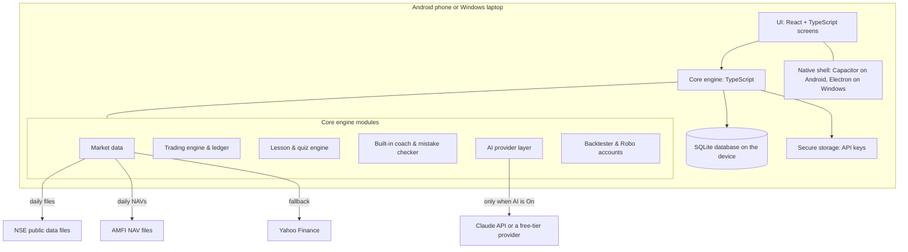

# System Specification (SSD v4.0)
## Market Learning App: Learn, Practise and Measure Trading on the Indian Market

**Document ID:** `SSD-MARKET-LEARN-v4.0`  
**Status:** DRAFT SPECIFICATION  
**Date:** 2026-10-26  
**Directory:** [`docs/astro-trader-app/`](./)  
**Implementation Plan:** [`MASTER_IMPLEMENTATION_PLAN.md`](MASTER_IMPLEMENTATION_PLAN.md) (MIP v4.0)  
**User-facing description:** [`APP_FUNCTIONALITY.md`](APP_FUNCTIONALITY.md)

> **Change from v3.0:** the app is no longer only a mock-trading engine. It becomes a single place to learn about the market: lessons, hands-on practice across instruments, honest measurement, and an AI tutor as the guide. The v3.0 strategy engine and five automatic accounts are kept as one feature ("Robo accounts"). All astrology was removed in v3.0 and stays out.

> **Education only.** No real money, no broker connection, no real orders. Nothing in the app is investment advice.

---

## 1. Purpose and Scope

### 1.1 Goal
Someone completely new to the market (the first users are Sunil and his son, a BBA student) should be able to learn, from this one app:
- how the Indian market works, from basics to derivatives, tax and trader psychology;
- how to place and manage trades in every major instrument, using realistic rules and charges;
- how to judge their own decisions honestly, with a journal, a mistake checker and measured results.

### 1.2 Three pillars, plus a guide

| Pillar | What it contains |
| :--- | :--- |
| **Learn** | Curriculum of lessons (Levels 1–6), glossary, quizzes, learning path |
| **Practise** | Trading desk (you place the orders), Time Machine (replay the past), Scenarios, Options Lab, Portfolio Builder |
| **Measure** | Trade journal, mistake checker, performance figures, progress tracker, Strategy Lab and Robo accounts |
| **Guide** | Built-in rule-based coach (always available) and the AI tutor (switchable) |

Every lesson ends with an exercise in Practise; every Practise screen links back to its lesson.

### 1.3 Platforms
- **Android:** installed from an APK file (no Play Store needed).
- **Laptop (Windows):** installed as a desktop app from the same code.
- **Each device works on its own.** There is no server. Progress moves between devices only through **Export / Import** (section 9).

---

## 2. Users and Profiles

- A device can hold several **profiles** (for example Sunil, Neil, Shine). Each profile has its own lessons progress, accounts, journal, settings and AI usage.
- An optional 4-digit PIN per profile stops family members opening each other's profile by accident (privacy convenience, not strong security).
- One profile can be marked **device owner**; only the owner can change the AI provider key and the device-wide AI spending limit.

---

## 3. Architecture

**Key decisions**
- **One TypeScript codebase** for engine and screens, wrapped by Capacitor (Android APK) and Electron (Windows). The engine runs entirely on the device.
- **Network calls go through the native shell**, not the browser layer, so NSE downloads and AI calls are not blocked by browser cross-origin rules.
- **SQLite** holds all user data and market history on the device.
- The existing Python and HTML prototype (`tools/live_agent/`, `app/`, `data/live_ledger/`, GitHub workflow) is **superseded**; its strategy and ledger rules are ported into the TypeScript engine.

---

## 4. Learn

### 4.1 Curriculum

| Level | Topic group | Main lessons |
| :--- | :--- | :--- |
| **1. Foundations** | How the market works | Exchanges (NSE/BSE), SEBI, brokers, demat, T+1 settlement; indices; market hours and pre-open; circuit limits; order types (market, limit, SL, SL-M, GTT); charges and contract notes |
| **2. Investing** | Building wealth | Shares and corporate actions; reading company results; P/E, P/B, ROE, debt; sectors; ETFs and index funds; mutual funds (NAV, SIP, expense ratio, direct vs regular); IPOs; bonds and G-secs (yield, duration); REITs/InvITs; diversification and asset allocation |
| **3. Trading** | Price-based decisions | Charts and candles; support and resistance; moving averages, RSI, volume; breakouts; swing vs positional vs intraday; position sizing, stop-loss, risk–reward, drawdown; short selling limits in cash market |
| **4. Derivatives** | Futures and options | Futures: lot size, margin, leverage, daily mark-to-market, expiry, rollover, open interest. Options: calls/puts, premium, strike, moneyness, time decay, implied volatility, Greeks; strategies (covered call, protective put, spreads, straddle, strangle, iron condor); why most retail F&O traders lose |
| **5. Other markets** | Beyond equities | Currency derivatives; commodities (MCX); bonds market; global markets, interest rates and their effect on Indian markets |
| **6. The trader** | Tax, mind, system | Capital gains tax, F&O income as business income, loss set-off, audit limits; psychology (fear, greed, overtrading, revenge trading); systematic trading, backtesting, overfitting |

### 4.2 Lesson format
- Each lesson is a Markdown file with front matter: id, level, title, prerequisites, estimated minutes, **facts used**, **review status** (`draft` / `reviewed`), **reviewed by**, **reviewed on**.
- A lesson has: explanation (with diagrams where useful), a worked Indian-market example, a short quiz (3–8 questions), and a **"Try it"** exercise that opens the right Practise screen pre-set (for example "place a stop-loss order on NIFTYBEES in the Time Machine, 2020-03").
- **Facts file** (`content/market_facts.json`): every rate or rule that can change (charges, tax rates and thresholds, margin percentages, expiry rules) is stored once with an **as-of date** and a source note. Lessons and the trading engine both read from it; a lesson shows "facts as of <date>".
- **Content review:** Claude drafts lessons; Sunil reviews them. Unreviewed lessons are shown with a "Draft" label.

### 4.3 Glossary, quizzes and the learning path
- **Glossary:** every term used in lessons and screens; tapping a highlighted term anywhere opens its entry.
- **Quizzes:** multiple choice and short numeric questions (for example "what is the breakeven of this call?"); each answer has a written explanation.
- **Learning path:** a recommended order through the lessons, adjusted by quiz results (a weak topic is suggested again later).
- **Progress:** lessons done, quiz scores per topic, exercises completed, practice statistics per level.

---

## 5. Practise

### 5.1 Practice account and instruments
Each profile has a **Practice account** (default ₹10,00,000 virtual cash, resettable) used by the trading desk.

| Instrument | Available from | Data | Notes |
| :--- | :--- | :--- | :--- |
| Stocks (NSE cash) | Stage 3 | NSE daily price file | Delivery (CNC) only |
| ETFs, index values | Stage 3 | NSE daily price file | Index values for charts and benchmark |
| Mutual funds | Stage 3 | AMFI daily NAV | Lump sum, SIP, redemption at NAV with cut-off rules |
| Index & stock futures | Stage 8 | NSE daily F&O file | Lot sizes, margin, daily mark-to-market, expiry |
| Index & stock options | Stage 8 | NSE daily F&O file | All strikes and expiries; Greeks and IV computed in the app |
| Currency derivatives | Stage 9 | NSE daily currency file | USD-INR futures and options |
| Commodities (MCX) | Stage 9 | Limited | Lessons plus a simplified simulator on a small set of contracts if data is obtainable |
| Bonds / G-secs | Stage 9 | Limited | Lessons plus a yield, price and duration calculator |
| Intraday | — | No reliable free source | Lessons only, plus a simplified exercise using each day's high and low |

### 5.2 Order types and fill rules (end-of-day prices)
Prices are daily (open, high, low, close). An order placed on day *D* is executed against day *D+1*'s prices:

| Order | Fill rule on day *D+1* |
| :--- | :--- |
| **Market** | Fills at *D+1* open, plus slippage |
| **Limit buy / sell** | Fills at the limit (or at the open if the open is better) if *D+1* low ≤ limit (buy) or high ≥ limit (sell); else stays open until cancelled or the day ends (DAY validity) |
| **Stop-loss (SL)** | Triggers if the trigger price is touched; then fills as a limit order at the given limit |
| **Stop-loss market (SL-M)** | Triggers if the trigger price is touched; fills at the trigger (or the open if the price gapped through it) plus slippage |
| **GTT** | Stays active up to one year; places the order on the day its trigger is touched |
| **Mutual fund buy / redeem** | At the NAV of the applicable day according to the cut-off rule in the facts file |

Other rules:
- Whole shares and whole lots only; orders that need more cash or margin than available are rejected with an explanation.
- No short selling in the cash market. Futures and options can be sold, subject to margin.
- Charges (brokerage, STT, exchange charges, SEBI fee, stamp duty, GST) come from the facts file and are shown on a **contract note** for every fill.
- Corporate actions (splits, bonuses) adjust holdings on the ex-date.
- **No look-ahead anywhere:** the engine never uses a price later than the moment being simulated.

### 5.3 Futures and options (Stage 8)
- Positions in lots; margin blocked on entry using **simplified margin percentages** from the facts file, labelled "approximate" (exchange SPAN margins may be added later).
- Daily mark-to-market for futures; options premium paid or received.
- Expiry handling: cash settlement for index contracts; the facts file states the physical-settlement rule for stock contracts, and the simulator closes such positions at expiry with an explanation.
- **Option chain screen:** strikes, premiums, open interest, IV and Greeks for the chosen date.

### 5.4 Time Machine (market replay)
- Choose a start date (from the bundled history), a starting cash amount and which instruments to allow.
- The app shows only data up to that date. You trade, then press **Next day** (or **Next week**); orders fill by the same rules as above.
- Several Time Machine sessions can be saved and resumed; each has its own account.
- At the end, a summary compares your result with buying the Nifty 50 at the start.

### 5.5 Scenarios
Ready-made challenges, each with a goal, a fixed date range, allowed instruments, and a debrief. Examples:
- "March 2020: protect a ₹10L portfolio through the crash"
- "Budget Day: trade the event without blowing up"
- "Sideways market: earn from time decay with a covered call"
- "Build an SIP and stay disciplined through 2022"

The debrief shows what you did, what happened next, and the lesson it connects to.

### 5.6 Options Lab
Build any option combination and see its payoff diagram at expiry and today, breakevens, maximum profit and loss, Greeks, and how the curve changes as days pass or IV moves. Works on real past option chains or on made-up inputs.

### 5.7 Portfolio Builder
Mix stocks, funds, bonds (via a yield model) and cash; see how the mix would have behaved over past years: return, worst fall, recovery time, and the effect of rebalancing.

---

## 6. Measure

### 6.1 Trade journal
Every manual order asks, before it is placed: **why?**, **target**, **exit if wrong**, **confidence (1–5)**. After the trade closes it asks: **what happened?** and **what did I learn?** The journal can be filtered and is the main input to reviews.

### 6.2 Mistake checker (built-in, no AI needed)
Rule-based checks run on every order and every week:

| Check | Example trigger |
| :--- | :--- |
| No exit plan | Order placed without a stop or exit note |
| Position too large | One position over 20% of account value (setting) |
| Averaging down | Buying more of a holding that is below its cost by over 5% |
| Revenge trading | A new trade within one day of a loss larger than 2% of the account |
| Overtrading | More trades in a week than the profile's limit |
| Holding losers, cutting winners | Average holding time of losing trades much longer than of winning trades |
| Leverage risk (F&O) | Margin used over 50% of the account |
| Undiversified | Over 40% of holdings in one sector |

Thresholds are settings. Each flag links to the relevant lesson.

### 6.3 Performance figures
For any account: total return, CAGR, maximum drawdown, win rate, average win and loss, number of trades, Sharpe ratio, total charges paid, and return against Nifty 50 buy-and-hold over the same period.

### 6.4 Strategy Lab and Robo accounts (from v3.0)
- **Strategy:** close above the highest high of the previous *N* days (default 20) with volume ≥ *M* × its *N*-day average (default 1.5×); stop-loss 5%; trailing stop 8%; maximum holding 60 days; 5-day re-entry cool-off. Universe: Nifty 100.
- **Strategy Lab:** change the settings and backtest on stored history with the same trading engine and charges as everything else.
- **Robo accounts** (per device, ₹10L each):

| Account | Behaviour |
| :--- | :--- |
| Index Benchmark | Buys a Nifty 50 ETF on day one and holds |
| Sunil | Strategy with 10% of value per position, market orders |
| Neil | 5% per position, limit orders at the previous close |
| Shine | 10% per position, forced exit after 10 trading days |
| Sandbox | Settings saved from the Strategy Lab |

- Robo accounts are processed **when the app opens**: it downloads any missing trading days and runs each missed day in order ("catch-up"), so no server or scheduled job is needed.

---

## 7. Guide: Built-in Coach and AI Tutor

### 7.1 Built-in coach (always available, free)
- Learning path suggestions, fixed hints on every screen, the mistake checker (6.2), prepared scenario debriefs, and written quiz explanations.
- When the AI is off or its limit is reached, the coach covers every place the AI would have answered, and says what the AI would add.

### 7.2 AI tutor modes

| Mode | Behaviour |
| :--- | :--- |
| **Off** | No AI calls. Built-in coach only. |
| **Preview** (default at install) | Shows prepared sample tutor conversations for each AI feature. No key, no cost, no network. |
| **On** | Live AI answers through the chosen provider and model, within the monthly limit. |

### 7.3 Providers and models
All AI calls go through one **AI provider layer** with a single interface, so providers are interchangeable by setting.

| Provider | Models | Cost | Notes |
| :--- | :--- | :--- | :--- |
| **Claude API** (Anthropic) | `claude-haiku-5-5` (default), `claude-sonnet-5-5`, `claude-opus-5-5` | Pay per use from a Claude Console account (a Claude Pro subscription does not cover API use) | Called with the official Anthropic TypeScript SDK; fixed system prompt cached; refusals handled by showing the built-in coach answer |
| **Free-tier provider** (initially Google Gemini API free tier) | Provider's free model | Free within the provider's daily limits | Free tiers may use submitted data to improve the provider's models; terms are checked and shown in the app before it can be enabled |

**Default routing (Claude):** Haiku 5.5 for quick features (ask-about-this-screen, quiz feedback, pre-trade check); **Opus 5.5 offered for deep reviews** (trade review, weekly review, scenario debrief). Each feature's model can be changed in settings.

### 7.4 AI features (each can be switched on or off)

| Feature | Trigger | What it uses |
| :--- | :--- | :--- |
| Learning guide | Home screen | Progress, quiz results, next lessons |
| Ask about this screen | Button on every screen | Current screen's data and the linked lesson |
| Pre-trade check | Before placing a practice order | Order, account, journal entry, mistake-checker flags |
| Trade review | When a trade closes | Trade, prices during the trade, journal entries |
| Weekly coach review | Once a week, on request | Last week's trades, journal and flags |
| Quiz feedback | After a wrong answer | Question, answer, related lesson, own trades |
| Scenario debrief | End of a scenario | Actions taken, what followed |

### 7.5 AI settings
AI mode; provider; model per feature; on/off per feature; **monthly limit in rupees** (device-wide, set by the device owner; default ₹200 when first switched On); usage meter (questions, tokens, estimated cost per feature this month); API key entry with a **Test key** button; a privacy note listing exactly what is sent.

### 7.6 Guardrails
- **Teaches, never tips:** the tutor explains and reviews; it does not tell anyone to buy or sell a real security, and declines questions about real-money trades in named stocks, pointing to the relevant lesson instead.
- **Grounded in app data:** every request includes the relevant screen data, lesson text and facts file entries; answers that cite a changeable fact show its as-of date.
- **Minimal data:** only practice-account data, journal text and lesson context are sent. No names, PINs, keys or contact details.
- **Cost control:** the app estimates each request's cost before sending, stops at the limit, and never retries more than once.
- **Failure behaviour:** no network, invalid key, provider error or limit reached → the built-in coach answer is shown with a short reason.

---

## 8. Market Data

| Data | Source | Update |
| :--- | :--- | :--- |
| Stocks, ETFs, indices (daily OHLCV) | NSE daily price files; Yahoo Finance as fallback | Downloaded on app open for each missing trading day |
| Mutual fund NAVs | AMFI daily NAV file; AMFI history for chosen schemes | On app open |
| Futures and options | NSE daily F&O file | On app open (Stage 8) |
| Currency derivatives | NSE daily currency file | On app open (Stage 9) |
| Trading holidays | Bundled calendar, updated with app releases | — |
| Corporate actions | Bundled adjustment file, updated with app releases | — |

- **Bundled history:** the installer includes a compressed starter history (Nifty 100 stocks, main ETFs and indices from 2015; selected mutual funds; index options for the most recent two years), so the Time Machine and Strategy Lab work offline from the first launch.
- **Data checks:** no duplicate dates, no zero or negative prices, high ≥ max(open, close), low ≤ min(open, close); bad rows are rejected and logged.
- **Download failures** never change any account; the app retries next time and shows the last data date.
- **Licence note:** data is for personal learning use. Before the app is shared outside the family, data redistribution terms must be checked (bundled history is the main concern).

---

## 9. Storage, Export and Import

- **SQLite tables (outline):** profiles, settings, lessons_progress, quiz_attempts, accounts, orders, fills, positions, nav_history, journal_entries, coach_flags, ai_usage, time_machine_sessions, scenario_runs, prices_daily, fo_daily, nav_daily, instruments.
- **Export:** a single `.mlbackup` file per profile (lessons progress, accounts, orders, journal, settings, AI usage). It never contains API keys or PINs. Market data is not exported (each device downloads its own).
- **Import:** on another device, choose the file; the app shows what will be replaced or merged and asks before applying. Accounts are identified by id, so importing the same file twice changes nothing.

---

## 10. Technology

| Area | Choice |
| :--- | :--- |
| Language | TypeScript throughout |
| UI | React, Vite build, a charting library for price and payoff charts |
| Android | Capacitor, built into a signed APK (sideloaded) |
| Windows | Electron, built into an installer |
| Database | SQLite through a Capacitor/Electron SQLite plugin |
| Secure key storage | Android Keystore (secure storage plugin); Electron `safeStorage` on Windows |
| AI | Official Anthropic TypeScript SDK for Claude; the free-tier provider's official SDK or REST API behind the same interface |
| Tests | Unit tests for the engine; end-to-end tests on the web build; manual checks on a real Android phone |

---

## 11. Non-Functional Requirements

- **Offline first:** everything except data downloads and AI On mode works without internet.
- **Performance:** app opens in under 3 seconds on a mid-range Android phone; a day's catch-up (download + robo processing) under 30 seconds; Time Machine "next day" under 1 second; a 5-year backtest under 10 seconds.
- **Size:** APK under 150 MB including bundled history.
- **Reliability:** every account change happens inside a database transaction; integrity checks (cash ≥ 0, account value = cash + holdings, cash movement = sells − buys − charges ± margin) run after each processed day and stop processing on failure.
- **Privacy:** no analytics, no tracking; network calls only to the data sources and the chosen AI provider.
- **Disclaimer:** shown at first launch and on the trading desk: "Practice and learning only. Not investment advice."

---

## 12. Out of Scope (v4.0)

- Real broker connection, real orders, live intraday prices.
- Syncing between devices (Export / Import only).
- Sharing with people outside the family (planned later as a hosted version with sign-up; needs data licensing and advice-rule checks).
- Dividends in account values (planned later).

---

## 13. Definition of Done

1. Installs from an APK on Android and from an installer on Windows; works offline after install except for downloads and AI.
2. Levels 1–6 lessons are present, each with quiz and "Try it" exercise, and each marked **reviewed**.
3. Every instrument in 5.1 marked available can be traded with the stated order types; fills, charges and margin match hand-worked examples in the test suite.
4. Time Machine, Scenarios, Options Lab and Portfolio Builder work on bundled history without internet.
5. Journal, mistake checker, performance figures and progress tracker work for every account type.
6. Strategy Lab and the five Robo accounts run through catch-up with no look-ahead (proven by test).
7. AI tutor works in Off, Preview and On modes, with every feature switchable, the monthly limit enforced, and the built-in coach taking over on any failure.
8. Export from one device and import on another restores a profile exactly, without keys.
9. Integrity checks pass on every processed day; no cash is created or lost.
