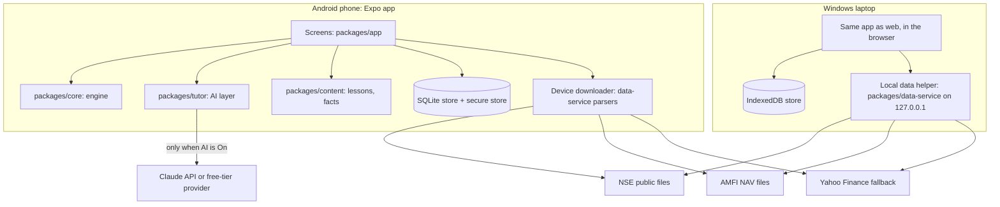

# System Specification (SSD v4.1)
## Market Learning App: Learn, Practise and Measure Trading on the Indian Market

**Document ID:** `SSD-MARKET-LEARN-v4.1`  
**Status:** DRAFT SPECIFICATION  
**Date:** 2026-10-26  
**Directory:** [`docs/astro-trader-app/`](./)  
**Implementation Plan:** [`MASTER_IMPLEMENTATION_PLAN.md`](MASTER_IMPLEMENTATION_PLAN.md) (MIP v4.1)  
**User-facing description:** [`APP_FUNCTIONALITY.md`](APP_FUNCTIONALITY.md)  
**Decision:** D42 in [`docs/DECISIONS.md`](../DECISIONS.md)

> **Change from v4.0:** v4.0 proposed a new Capacitor/Electron app. It overlooked the existing TypeScript workspace (`packages/*`): an Expo mock-trading app, a tested trading engine and a market-data service, with owner-accepted UAT rounds 1 and 2 and 1,039 passing tests. v4.1 builds the learning platform **on that workspace**: Expo for Android and the web app for the laptop, the existing core engine and data service reused. The product scope (Learn, Practise, Measure, AI tutor) is unchanged from v4.0.

> **Education only.** No real money, no broker connection, no real orders. Nothing in the app is investment advice.

---

## 1. Purpose and Scope

### 1.1 Goal
Someone completely new to the market (the first users are Sunil and his son, a BBA student) should be able to learn, from this one app:
- how the Indian market works, from basics to derivatives, tax and trader psychology;
- how to place and manage trades in every major instrument, using realistic rules and charges;
- how to judge their own decisions honestly, with a journal, a mistake checker and measured results.

### 1.2 Three pillars, plus a guide

| Pillar | What it contains |
| :--- | :--- |
| **Learn** | Curriculum of lessons (Levels 1–6), glossary, quizzes, learning path |
| **Practise** | Trading desk (you place the orders), Time Machine (replay the past), Scenarios, Options Lab, Portfolio Builder |
| **Measure** | Trade journal, mistake checker, performance figures, progress tracker, Strategy Lab and Robo accounts |
| **Guide** | Built-in rule-based coach (always available) and the AI tutor (switchable) |

Every lesson ends with an exercise in Practise; every Practise screen links back to its lesson.

### 1.3 Platforms
- **Android:** the Expo app (`packages/app`) built into a sideloaded APK, following [`TRADING_APP_RUNBOOK.md`](../TRADING_APP_RUNBOOK.md).
- **Laptop (Windows):** the same Expo app as a web app in the browser, plus the existing local **data helper** (`packages/data-service`) that downloads market data for it. One command (and later a desktop shortcut) starts both.
- **Each device works on its own.** No server. Progress moves between devices only through **Export / Import** (section 9).

### 1.4 Relation to the rest of the repository
- `packages/core`, `packages/data-service` and `packages/app` become the learning app. Their engineering rules (strict TypeScript, injected clock, integer paise, seeded randomness, core import boundary) stay in force.
- `trading_app_ssd_v0_9.md`, `MASTER_IMPLEMENTATION_PLAN.md` (v1.2) and `PROGRESS_TRACKER.md` continue to govern the **research** work (`packages/research`, `packages/workers`, `packages/astro-engine`, the PH register). For the app, this SSD governs (D42).
- **No astrology in the app.** The app's optional astro layer (Profile tab, birth vault, shields, astro gate) is removed from `packages/app`, and the app no longer depends on `@trading/astro-engine`. The research packages are untouched.

---

## 2. Users and Profiles

- A device holds several **profiles** (for example Sunil, Neil, Shine). Each profile has its own lessons progress, accounts, journal, settings and AI usage. Storage keys are namespaced by profile id.
- An optional 4-digit PIN per profile (stored as a salted hash) stops family members opening each other's profile by accident. It is a convenience, not strong security.
- One profile is the **device owner**; only the owner can change AI provider keys and the device-wide AI spending limit.
- On first launch after the upgrade, any existing single-user data (paper orders, last export time) moves into a first profile named "Owner".

---

## 3. Architecture

**Packages**

| Package | Role in the learning app | Status |
| :--- | :--- | :--- |
| `packages/core` | Trading engine: money, domain types, fills (circuits, exits), costs, calendar, corporate actions, ledger (double entry, FIFO, reconcile), risk limits, analytics, replay, signed bundles | Exists; extended (order types, instrument kinds, accounts) |
| `packages/data-service` | Parsers for NSE bhavcopy, Yahoo and AMFI; canonical series; corporate actions; cross-check; the local HTTP service used as the laptop data helper | Exists; platform-neutral parsers made usable on the phone |
| `packages/app` | Expo app (web and Android): screens, view models, storage seam, backup | Exists; astro layer removed; profiles, Learn, Tutor and the rest added |
| `packages/content` | Lessons (Markdown), quizzes, glossary, scenarios, facts file, AI Preview samples | New |
| `packages/tutor` | AI provider layer, context builders, guardrail checks; no DOM or Node imports | New |
| `packages/research`, `workers`, `astro-engine` | Research pipeline; also builds the bundled price history | Exist; not part of the app |

**Key decisions**
- **One TypeScript codebase**, the existing Expo universal app. No Electron or Capacitor.
- **The core import boundary stays.** Core imports nothing from app, tutor, Node or DOM. The tutor may read core types; nothing in core or the order path may import the tutor.
- **Phone downloads directly.** React Native `fetch` is not subject to browser cross-origin rules, so the phone fetches NSE and AMFI files itself, using the data-service parsers. The Node-only zip step (`node:zlib`) is replaced by a pure-JS inflate in the shared path.
- **Laptop uses the local data helper.** The browser cannot fetch NSE files directly (cross-origin), so the existing data service runs locally and the web app reads `/bars`, `/instruments`, `/actions` and `/status` from it.
- **The signed daily snapshot (D26) is not used by the app.** Each device gets its own data. The snapshot code stays in the repository for the research pipeline.

---

## 4. Learn

### 4.1 Curriculum

| Level | Topic group | Main lessons | Existing source material |
| :--- | :--- | :--- | :--- |
| **1. Foundations** | How the market works | Exchanges, SEBI, brokers, demat, T+1; indices; market hours and pre-open; circuits; order types; charges and contract notes | Investor Guide 1 §1–3; Guide 2 §1, §3, §5 |
| **2. Investing** | Building wealth | Shares and corporate actions; results and ratios; sectors; ETFs and index funds; mutual funds; IPOs; bonds and G-secs; gold, REITs, InvITs; asset allocation | Guide 1 §4–8; Guide 4 §1, §3 |
| **3. Trading** | Price-based decisions | Charts and candles; support and resistance; moving averages, RSI, volume; breakouts; swing vs positional vs intraday; sizing, stops, risk–reward, drawdown; short selling | Guide 2 §2, §4; Guide 4 §2, §5 |
| **4. Derivatives** | Futures and options | Contract specs; futures margin, MTM, rollover; options, payoffs, pricing, Greeks, IV and India VIX; strategies; expiry and settlement; leverage; SEBI studies; F&O costs and tax | Guide 3 §1–14 |
| **5. Other markets** | Beyond equities | Currency derivatives; commodities; bond market; global markets and interest rates | Guide 1 §6, §8 |
| **6. The trader** | Tax, mind, system | Capital gains and F&O tax; behavioural traps; scams and false promises; crashes in context; habits; investor protection; systematic trading and overfitting | Guide 2 §6; Guide 4 §4, §6–12 |

The four Investor Guides and `Stock_Market_Data_Learning_Guide.md` are the starting drafts; lessons are cut from them, shortened, given quizzes and "Try it" exercises, and re-reviewed.

### 4.2 Lesson format
- Each lesson is a Markdown file in `packages/content` with front matter: id, level, title, prerequisites, estimated minutes, **facts used**, **review status** (`draft` / `reviewed`), **reviewed by**, **reviewed on**.
- A lesson has: explanation (diagrams where useful), a worked Indian-market example, a quiz (3–8 questions) and a **"Try it"** exercise that opens the right Practise screen pre-set.
- **Facts file:** every rate or rule that can change is stored once with an **as-of date** and a source note. Equity cash charges already exist as the effective-dated schedule in `packages/core/src/costs/schedule.ts` (sourced from `docs/data-sources/india_equity_cost_rates_2020-04-01_to_2026-10-16.csv`); the facts file references it and adds the rest (tax rates and thresholds, F&O charges, margin percentages, expiry rules, mutual fund cut-offs). Lessons show "facts as of <date>".
- **Content review:** Claude drafts; Sunil reviews. Unreviewed lessons show a "Draft" label.

### 4.3 Glossary, quizzes and the learning path
- **Glossary:** every term used in lessons and screens (the guides' glossaries are the start); tapping a highlighted term opens its entry.
- **Quizzes:** multiple choice and numeric; each answer has a written explanation. The guides' self-check sections are the start.
- **Learning path:** a recommended order, adjusted by quiz results.
- **Progress:** lessons done, quiz scores per topic, exercises completed, practice statistics per level.

---

## 5. Practise

### 5.1 Practice account and instruments
Each profile has a **Practice account** (default ₹10,00,000 virtual cash, resettable). The existing paper book (`PaperSession`, `PaperExecutionAdapter`) becomes this account, moved from the demo data to real data in Stage 2.

| Instrument | Available from | Data | Engine today |
| :--- | :--- | :--- | :--- |
| Stocks (NSE cash) | Stage 3 | NSE bhavcopy | Supported (`kind: equity`) |
| ETFs, index values | Stage 3 | NSE bhavcopy, index closes | New instrument kind; index closes already pulled |
| Mutual funds | Stage 3 | AMFI NAV | New; AMFI parsing exists for sizing |
| Index & stock futures | Stage 8 | NSE F&O file | New |
| Index & stock options | Stage 8 | NSE F&O file | New |
| Currency derivatives | Stage 9 | NSE currency file | New |
| Commodities (MCX) | Stage 9 | Limited | Lessons plus a simplified simulator if data is obtainable |
| Bonds / G-secs | Stage 9 | Limited | Lessons plus a calculator |
| Intraday | — | No reliable free source | Lessons only, plus a simplified high/low exercise |

### 5.2 Order types and fill rules
The existing fill rules stay: decisions after the close fill at the **next session's open** (D3); circuits, suspensions and trade-for-trade status are honoured by `packages/core/src/fills`. Existing types: market and limit, DAY validity. Added in Stage 3:

| Order | Fill rule on the next session |
| :--- | :--- |
| **Stop-loss (SL)** | Triggers if the trigger price is touched; then behaves as a limit order |
| **Stop-loss market (SL-M)** | Triggers if touched; fills at the trigger, or at the open if the price gapped through it, plus slippage |
| **GTT** | Active up to one year; places its order on the session its trigger is touched |
| **Mutual fund buy / redeem** | At the NAV of the applicable day per the cut-off rule in the facts file |

Other rules: whole shares and lots; orders beyond available cash or margin are refused with a reason (the existing `RefusalReason` set is extended); no cash-market short selling; charges from the cost schedule and facts file on a **contract note** per fill; corporate actions adjust holdings (existing); **no look-ahead**, enforced by the replay design and a test.

### 5.3 Futures and options (Stage 8)
Lots; margin blocked using simplified percentages from the facts file, labelled "approximate"; daily mark-to-market for futures; premium flows for options; expiry settlement per the facts file; option chain with OI, IV and Greeks.

### 5.4 Time Machine (market replay)
Built on `packages/core/src/replay`. Choose a start date, starting cash and allowed instruments; the app shows only data up to that date; trade, then **Next day** / **Next week**; save and resume sessions; end summary against Nifty 50 buy-and-hold.

### 5.5 Scenarios
Ready-made challenges with a goal, date range, allowed instruments, checkpoints and a debrief (for example "March 2020: protect a ₹10L portfolio", "Budget Day", "Covered call in a sideways market", "SIP through 2022"). Guide 4 §8 (crashes in context) is a source.

### 5.6 Options Lab
Payoff today and at expiry, breakevens, maximum profit and loss, Greeks, sliders for days and IV; on real past chains or made-up inputs.

### 5.7 Portfolio Builder
Mix stocks, funds, bonds (yield model) and cash; historical return, worst fall, recovery time, and the effect of rebalancing.

---

## 6. Measure

### 6.1 Trade journal
Before each manual order: **why?**, **target**, **exit if wrong**, **confidence (1–5)**. After it closes: **what happened?**, **what did I learn?**, optional emotion tag.

### 6.2 Mistake checker (built-in, no AI)
Rule-based checks on every order and weekly, using the existing risk limits (`packages/core/src/risk`) where they apply:

| Check | Example trigger |
| :--- | :--- |
| No exit plan | Order placed without a stop or exit note |
| Position too large | One position over 20% of account value (setting) |
| Averaging down | Buying more of a holding that is below cost by over 5% |
| Revenge trading | A new trade within one day of a loss over 2% of the account |
| Overtrading | More trades in a week than the profile's limit |
| Holding losers, cutting winners | Losing trades held much longer than winning trades on average |
| Leverage risk (F&O) | Margin used over 50% of the account |
| Undiversified | Over 40% of holdings in one sector (sectors exist in the instrument model) |

Thresholds are settings; each flag links to its lesson.

### 6.3 Performance figures
From the existing analytics (`winLossReport`, trade metrics, comparators) plus: total return, CAGR, maximum drawdown, win rate, average win and loss, trades, Sharpe ratio, charges paid, and comparison with Nifty 50 buy-and-hold. The existing Ledger B comparators (what holding 5, 20 or 60 sessions longer would have given, and what happened after the exit) are kept as a **"What if I had held?"** view.

### 6.4 Strategy Lab and Robo accounts
- **Strategy:** close above the previous *N*-day high (default 20) with volume ≥ *M* × average (default 1.5×); stop 5%; trailing stop 8%; maximum hold 60 days; 5-day re-entry cool-off. Universe: the existing ~100-name universe.
- **Strategy Lab:** settings, backtest on stored history with the same engine and charges.
- **Robo accounts** per device (₹10L each): Index Benchmark (buy and hold a Nifty 50 ETF), Sunil (10% per position, market), Neil (5%, limit at previous close), Shine (10%, forced exit after 10 sessions), Sandbox (Strategy Lab settings). Processed by **catch-up when the app opens** (missed sessions run in order, with data as of each session only, per runbook R5 rule 4).

---

## 7. Guide: Built-in Coach and AI Tutor

### 7.1 Built-in coach (always available, free)
Learning path suggestions, fixed hints on every screen, mistake-checker explanations, prepared scenario debriefs, written quiz explanations. When the AI is off, fails or hits its limit, the coach answers instead and says what the AI would add.

### 7.2 AI tutor modes

| Mode | Behaviour |
| :--- | :--- |
| **Off** | No AI calls. Built-in coach only. |
| **Preview** (default at install) | Prepared sample tutor conversations for each feature, bundled in `packages/content`. No key, no cost, no network. |
| **On** | Live answers through the chosen provider and model, within the monthly limit. |

### 7.3 Providers and models

| Provider | Models | Cost | Notes |
| :--- | :--- | :--- | :--- |
| **Claude API** | `claude-haiku-5-5` (default), `claude-sonnet-5-5`, `claude-opus-5-5` | Pay per use from a Claude Console account (a Claude Pro subscription does not cover API use) | Official Anthropic TypeScript SDK; fixed system prompt cached; refusals handled by showing the coach answer |
| **Free-tier provider** (initially Google Gemini free tier) | Provider's free model | Free within daily limits | Free tiers may use submitted data for training; terms re-checked in Stage 5 and shown in the app before enabling |

Default routing (Claude): Haiku 5.5 for quick features; **Opus 5.5 offered for deep reviews** (trade, weekly, scenario). Each feature's model is a setting.

### 7.4 AI features (each switchable)

| Feature | Trigger | Context sent |
| :--- | :--- | :--- |
| Learning guide | Home screen | Progress, quiz results, next lessons |
| Ask about this screen | Button on every screen | Screen data, linked lesson |
| Pre-trade check | Before a practice order | Order, account, journal entry, coach flags |
| Trade review | When a trade closes | Trade, prices during it, journal |
| Weekly coach review | On request, weekly | Week's trades, journal, flags |
| Quiz feedback | After a wrong answer | Question, answer, lesson, own trades |
| Scenario debrief | End of a scenario | Actions taken, what followed |

### 7.5 AI settings
Mode; provider; model per feature; on/off per feature; **monthly rupee limit** (device-wide, owner only; ₹200 default when first switched On); usage meter; key entry with **Test key**; privacy note listing exactly what is sent.

### 7.6 Rules for the tutor (revision of runbook R15–R17 for a teaching app)
The runbook's AI rules were written for the research experiment, where AI could only turn verified facts into text. A tutor must also explain general concepts. The rules for the app become:

| Runbook rule | In the learning app |
| :--- | :--- |
| R15.1 AI is downstream only | **Kept.** AI output never feeds orders, the ledger, the mistake checker or the Robo accounts; an import-boundary test enforces it, and a run with AI off gives identical accounts. |
| R15.2 No raw source text to the model | **Kept** for downloaded market files; lesson text and the user's own journal text may be sent. |
| R15.3 No tools, browsing or memory | **Kept** (no tools, no browsing). A feature may keep a short conversation thread within one session. |
| R15.5 No recalled knowledge | **Relaxed** for teaching: the tutor may explain general concepts. Changeable facts (rates, rules, lot sizes) must come from the facts file in the context, shown with their as-of dates. |
| R16.1–2 Fact pack and placeholders | **Kept for the user's own numbers:** figures about the user's account and trades are inserted by code from the context, not typed by the model. |
| R16.4 Deterministic verifier | **Kept and adapted:** before display, code checks for advice phrases ("buy", "sell", "should invest" about a named real security, predictions with "will"), unknown tickers, and account figures not in the context. A failed check shows the coach answer. |
| R16.5–6 Fallback; facts visible | **Kept:** the coach answer on any failure; the facts used are shown under each answer. |
| R17 Provenance | **Simplified:** each AI answer is stored with model id, prompt template version, context hash and verifier result, so reviews can be reopened without a new call. |
| R5 Allowlist; "plain HTTPS, not a vendor SDK" | **Allowlist kept** (AI hosts added to `docs/network-allowlist.md`). The official Anthropic SDK is used; the headers it adds (SDK version, platform) are listed in the allowlist entry. |

Further: the tutor **teaches, never tips** (declines real-money stock questions, pointing to the lesson); only practice data, journal text and lesson context are sent, never names, PINs or keys; the app estimates cost before each call, stops at the limit and retries at most once.

---

## 8. Market Data

| Data | Source | Phone | Laptop |
| :--- | :--- | :--- | :--- |
| Stocks, ETFs (daily OHLCV) | NSE bhavcopy (legacy and UDiFF formats, back to 1994); Yahoo fallback | Device downloader with data-service parsers | Local data helper (`/bars`) |
| Index closes | Existing index puller | Device downloader | Data helper |
| Corporate actions | NSE actions; Yahoo splits/dividends | Device downloader | Data helper (`/actions`) |
| Status (circuits, ASM/GSM, suspensions) | Existing status recorder | Device downloader | Data helper (`/status`) |
| Mutual fund NAVs | AMFI | Device downloader | Data helper (new route) |
| Futures and options | NSE F&O file | Stage 8 | Stage 8 |
| Currency derivatives | NSE currency file | Stage 9 | Stage 9 |
| Trading calendar | `packages/core/src/calendar` (generated archive calendar) | Bundled | Bundled |

- **Bundled history:** the app ships a compressed starter history for the existing universe, main ETFs and indices from 2015 and selected mutual funds (index options two years, Stage 8), built by a `workers` job from the data-service store. The Time Machine and Strategy Lab work offline from the first launch.
- **Data checks:** the existing canonicalisation and cross-check (D4: 0.5% tolerance) apply; bad rows are refused and logged.
- **Failures** never change any account; the app shows the last data date and retries next time (no silent fallback, runbook R5).
- **Licence note:** personal learning use. Before any sharing outside the family, redistribution terms must be checked (the bundled history is the main concern).

---

## 9. Storage, Export and Import

- **Storage seam:** the existing `KeyValueStore` interface (`packages/app/src/store/kv.ts`): IndexedDB on the web (exists), **SQLite on Android** (`expo-sqlite`, Stage 1), memory in tests. Market history uses a separate table store added in Stage 2 (SQLite on Android, IndexedDB on the web).
- **Secure store seam:** API keys and PIN hashes go through one interface: `expo-secure-store` (Android Keystore) on the phone; on the web, values encrypted with a non-extractable WebCrypto key kept in IndexedDB (weaker than an OS keystore; stated in the app).
- **Export:** the existing signed bundle (`packages/core/src/bundle`, device key, FR-X1/X4 weekly reminder) is extended to a **per-profile backup**: profile, settings, orders, accounts, journal, lessons progress, AI usage. It never contains API keys, PINs or market data.
- **Import:** the existing signed-bundle import (signature check, snapshot id check) plus a preview of what will be added or replaced and a confirmation. Bundles made by the current app version still import (into the "Owner" profile).

---

## 10. Technology

| Area | Choice |
| :--- | :--- |
| Language | TypeScript, strict (existing `tsconfig.base.json`) |
| Workspace | pnpm workspaces (existing) |
| App | Expo SDK 58, React Native 0.88, React 19, react-native-web (existing) |
| Android build | Expo build profiles per runbook R1–R4; local Gradle build (Android SDK 34–37 installed on the laptop) and CI build |
| Storage | IndexedDB (web, existing); `expo-sqlite` (Android); `expo-secure-store` (Android keys) |
| Data | Existing data-service parsers; pure-JS inflate for zip files on the phone |
| AI | Official Anthropic TypeScript SDK; free-tier provider's official SDK or REST behind the same interface |
| Tests | Vitest and fast-check (existing, 1,039 tests); existing browser e2e scripts in `tools/e2e`; manual checks on a real phone per runbook §11 |
| Checks | `pnpm verify`: typecheck, lint (with import boundaries), size, dependency cycles, tests |

---

## 11. Non-Functional Requirements

- **Offline first:** everything except downloads and AI On works without internet (existing NFR-6 behaviour extended).
- **Performance:** app opens in under 3 seconds on a mid-range phone (runbook R4); catch-up of a missed week under 30 seconds on Wi-Fi; Time Machine "next day" under 1 second; a 5-year backtest under 10 seconds.
- **Size:** APK under 150 MB including bundled history (runbook R3 budget).
- **Determinism:** injected clock, seeded randomness, integer paise (runbook R6–R8; existing).
- **Integrity:** existing ledger reconcile checks after each processed session; processing stops on failure.
- **Privacy:** no analytics or tracking; outbound hosts only as listed in the allowlist (runbook R5, R14).
- **Disclaimer** at first launch and on the trading desk: "Practice and learning only. Not investment advice."

---

## 12. Out of Scope (v4.1)

Real broker connection or orders; live intraday prices; automatic sync between devices; sharing outside the family (later hosted version, after data-licence and advice-rule checks, cf. D32); dividends in account values (later); any astrology in the app.

---

## 13. Definition of Done

1. Installs from an APK on Android; runs in the browser on Windows with the data helper; works offline after install except downloads and AI.
2. Levels 1–6 lessons present, each with quiz and "Try it" exercise, each marked **reviewed**.
3. Every instrument marked available in 5.1 can be traded with the stated order types; fills, charges and margin match hand-worked tests.
4. Time Machine, Scenarios, Options Lab and Portfolio Builder work on bundled history without internet.
5. Journal, mistake checker, performance figures and progress work for every account type.
6. Strategy Lab and Robo accounts run through catch-up with no look-ahead (test).
7. AI tutor works in Off, Preview and On, every feature switchable, limit enforced, coach fallback on any failure; AI-off accounts identical to AI-on accounts.
8. Export on one device and import on the other restores a profile exactly, without keys.
9. `pnpm verify` passes; the runbook release gate (§12) passes for each release APK.
