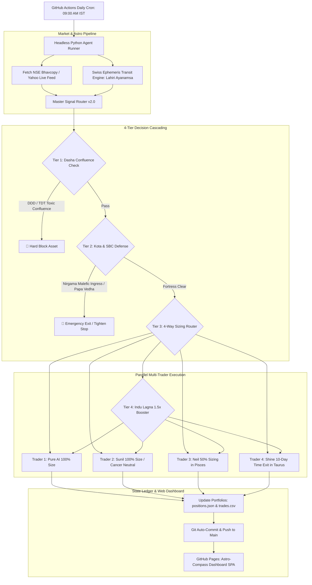

# System Architecture & Software Specification Document (SSD v1.0)
## Astro-Compass Dashboard & Automated 4-Trader Live Execution Agent

**Document ID:** `SSD-ASTRO-TRADER-v1.0`  
**Status:** DRAFT SPECIFICATION (Pre-Development Approval)  
**Date:** 2026-10-25  
**Directory:** [`docs/astro-trader-app/`](file:///c:/Users/Admin/Sunil/Trading/docs/astro-trader-app/)  
**Foundation Standards:** [FINAL_MASTER_THESIS.md](file:///c:/Users/Admin/Sunil/Trading/docs/jathakam-dasha-study/FINAL_MASTER_THESIS.md), [MASTER_REVERIFICATION_SYNTHESIS_REPORT.md](file:///c:/Users/Admin/Sunil/Trading/docs/buyer-kundli-reverification/MASTER_REVERIFICATION_SYNTHESIS_REPORT.md)

---

## 1. Executive Vision & Objectives

The **Astro-Compass Dashboard & 4-Trader Automated Paper-Trading Engine** is an institutional-grade, zero-cost, serverless trading ecosystem. 

It executes systematic quantitative and astro-financial trading strategies daily at market open, simultaneously managing **four distinct parallel portfolios**:
1. **Trader 1 (Pure AI Control):** Unbiased asset signals (baseline benchmark).
2. **Trader 2 (Sunil - Father):** Sagittarius Moon / Pisces Lagna (Protected by Jupiter Exaltation Shield in Cancer).
3. **Trader 3 (Neil - Son):** Leo Moon / Gemini Lagna (Subject to 50% sizing cut & limit orders during Moon in Pisces, $p = 0.029$).
4. **Trader 4 (Shine - Brother):** Libra Moon / Aries Lagna (Enforced 10-day strict trailing stop during Moon in Taurus).

### Key Architectural Tenets:
* **Option B Serverless Cloud Deployment:** Hosted completely on GitHub via **GitHub Actions** (daily cron triggers at 09:00 AM IST) and **GitHub Pages** (interactive HTML/CSS/JS dashboard).
* **Zero Infrastructure Cost:** No rented cloud servers or persistent VPS subscriptions required.
* **Audit-Proof State Management:** All trade logs, ledger balances, order fills, and equity curves are stored in cryptographically signed JSON/CSV files committed directly to the Git repository.

---

## 2. High-Level System Architecture



---

## 3. The 4-Trader Cohort Specification

Each trader operates with an independent virtual ledger balance of **₹1,000,000 (10 Lakhs)**:

| Cohort | Profile Name | Astrological Parameters | Behavioral Execution Rule | Max Single Position |
| :--- | :--- | :--- | :--- | :--- |
| **Trader 1** | **Pure AI Agent** | None (Control Group) | Executes pure asset breakout signals blindly. No personal astrological filtering. | ₹100,000 (10% max) |
| **Trader 2** | **Sunil (Father)** | Lagna: Pisces<br>Moon: Sagittarius (*Mula*)<br>Indu Lagna: Scorpio | **Full 100% Sizing.** Moon in Cancer is protected by Jupiter's Exaltation Shield ($p = 0.966$). Alpha boost (1.5x) when Jupiter/Venus transits Scorpio/Pisces/Cancer. | ₹100,000 (₹150,000 on Indu Boost) |
| **Trader 3** | **Neil (Son)** | Lagna: Gemini<br>Moon: Leo (*Magha*)<br>Indu Lagna: Aquarius | **Defensive Sizing.** Moon in Pisces triggers automated **50% size reduction** and mandatory limit orders ($p = 0.029$). Alpha boost (1.5x) when Jupiter/Venus transits Aquarius/Gemini/Libra. | ₹50,000 (in Pisces)<br>₹100,000 (Normal) |
| **Trader 4** | **Shine (Brother)** | Lagna: Aries<br>Moon: Libra (*Swati*)<br>Indu Lagna: Pisces | **Horizon Decay Protection.** Moon in Taurus enforces strict **10-day time exit** to prevent observed 20d return decay. Alpha boost (1.5x) when Jupiter/Venus transits Pisces/Cancer/Scorpio. | ₹100,000 (10-day exit lock) |

---

## 4. Master Signal Router v2.0 Logic

Every trading morning at 09:15 AM IST, the engine evaluates candidates using the empirically verified four tiers:

### Tier 1: Asset Dasha Confluence Check (Macro Filter)
* **Rule:** If the company is currently transiting through a Triple Dusthana (`[D-D-D]`) or Wealth Destroyer (`[T-D-T]`) sub-period, the stock is marked 🔴 **RED HARD BLOCK**. Zero buying permitted.

### Tier 2: Kota Chakra & SBC Papa Vedha (Flash-Crash Defense)
* **Rule:** If natural malefics (Saturn or Mars) breach the 10th or 19th Nakshatras (*Nirgama Nadis*) in the company's Kota Chakra, or if heavy *Papa Vedha* rays target the corporate ticker without benefic relief ($p = 8.86 \times 10^{-6}$):
  * Existing open positions: Trigger trailing stop tightening to $-2\%$.
  * New buy signals: Blocked immediately.

### Tier 3: Personalized Buyer Kundli Sizing (Human Factor Protection)
* Evaluates the Moon's transit sign at 09:15 AM IST:
  * If Moon is in **Pisces**, cut Neil's allocated quantity by $50\%$ and convert market orders to limit orders at $Close_{T-1}$.
  * If Moon is in **Taurus**, attach an auto-exit countdown timer ($T + 10$ trading days) to Shine's portfolio.
  * If Moon is in **Cancer**, Sunil trades at standard $100\%$ size.

### Tier 4: Indu Lagna & SBC Subha Vedha (The Wealth Booster)
* **Rule:** When transit Jupiter or Venus occupies 1, 4, 5, 7, 9, 10 relative to the company's Indu Lagna and/or the Trader's personal Indu Lagna ($p = 6.38 \times 10^{-13}$), allocation size scales from $1.0\text{x}$ to $1.5\text{x}$ (High-Conviction Alpha Entry).

---

## 5. System Components & File Layout

```
Trading/
├── .github/
│   └── workflows/
│       └── daily_paper_trading.yml   # GitHub Actions automation workflow
├── app/                              # Astro-Compass Dashboard SPA (Vanilla Web)
│   ├── index.html                    # Single Page Application
│   ├── css/
│   │   └── dashboard.css             # Heritage-Gold & Deep Navy modern dark UI
│   ├── js/
│   │   ├── app.js                    # SPA state and live chart controller
│   │   ├── astro_compass.js          # Interactive 81-grid SBC & Kota visualizer
│   │   └── portfolio_viewer.js       # 4-trader performance comparator
│   └── assets/
│       └── logo.svg
├── data/
│   └── live_ledger/                  # Persistent Git-committed ledger
│       ├── trader1_ai.json
│       ├── trader2_sunil.json
│       ├── trader3_neil.json
│       ├── trader4_shine.json
│       ├── master_trade_history.csv
│       └── daily_signals.json
├── tools/
│   └── live_agent/
│       ├── daily_market_feed.py      # EOD / Live price fetcher
│       ├── ephemeris_transit_live.py # Daily planetary coordinates
│       ├── master_router_v2.py       # Core decision logic
│       ├── order_execution_sim.py    # Simulated limit/market fills & slippage
│       └── ledger_manager.py         # Balance, NAV, and PnL bookkeeper
└── docs/
    └── astro-trader-app/
        └── SYSTEM_SPECIFICATION_v1.md
```

---

## 6. Frontend Dashboard Design Specification

The dashboard will be a state-of-the-art Single Page Application (SPA) built using **HTML5, Vanilla CSS3 (Custom Design System with Heritage Gold accents), and Vanilla JavaScript**:

### Visual & Functional Modules:
1. **The Daily Astro-Compass Ring:**
   * Visualizes the current day's Panchanga, Moon Nakshatra, and transit degree.
   * Color-coded status rings for all 4 traders (🟢 Green = Clean / Indu Boost, 🟡 Yellow = Chandrashtama Alert, 🔴 Red = Dasha Block).
2. **Interactive Sarvatobhadra Chakra (SBC) 81-Grid:**
   * A 9x9 interactive matrix highlighting active planetary rays (*Agra, Pashchaat, Vaama, Dakshina Vedha*) on watched tickers.
3. **4-Trader Equity Curve & Metric Leaderboard:**
   * Live comparative charting comparing Cumulative Return (%), Sharpe Ratio, Win Rate (%), and Maximum Drawdown across all four portfolios.
4. **Daily Action Feed (Buy/Sell/Hold Alerts):**
   * Clear, transparent logs showing why a trade was taken, which Tier authorized it, and how the sizing was modified.

---

## 7. Implementation Roadmap & Milestones

| Milestone | Deliverable | Timeline | Acceptance Test |
| :--- | :--- | :--- | :--- |
| **M1: Core Execution Engine** | `tools/live_agent/master_router_v2.py` & ledger manager | Day 1–2 | Offline dry-run creates valid mock trade orders for 4 traders |
| **M2: GitHub Actions Workflow** | `.github/workflows/daily_paper_trading.yml` | Day 3 | Automatic daily execution at 09:00 AM IST commits fresh JSON |
| **M3: Astro-Compass Dashboard** | `app/index.html`, `dashboard.css`, `app.js` | Day 4–5 | Responsive, premium UI loads data dynamically from repo JSON |
| **M4: GitHub Pages Deployment** | Live URL deployment | Day 6 | User can open mobile/desktop URL anytime to see live paper trades |

---

## 8. Safety & Compliance Constraints

1. **Paper-Trading Only:** The application operates exclusively with simulated mock capital. Zero live brokerage API keys (Zerodha, Upstox, etc.) are connected.
2. **Immutable Audit Trail:** All state changes are committed to Git with commit messages timestamped in IST. No trade can be modified after the market open timestamp.
3. **Fail-Safe Sizing:** Even under maximum Tier 4 Alpha Boost, no single trade may exceed 15% of a trader's net liquid capital.
