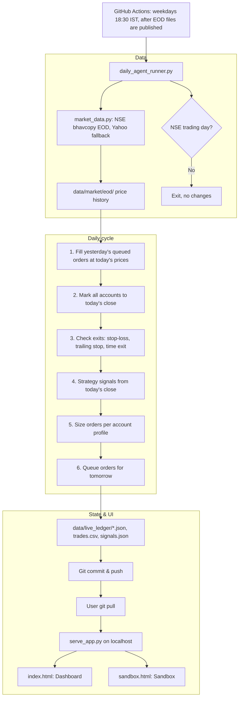

# System Specification (SSD v3.0)
## Mock Trading App: 5-Account Paper-Trading Engine, Dashboard & Strategy Sandbox

**Document ID:** `SSD-MOCK-TRADER-v3.0`  
**Status:** DRAFT SPECIFICATION  
**Date:** 2026-10-26  
**Directory:** [`docs/astro-trader-app/`](./)  
**Implementation Plan:** [`MASTER_IMPLEMENTATION_PLAN.md`](MASTER_IMPLEMENTATION_PLAN.md)

> **Scope note (v3.0):** All astrology (jyothisham) logic has been removed from the product. The app is a plain mock (paper) trading system on NSE equities. No real orders are placed and no broker is connected.

---

## 1. Purpose & Objectives

The Mock Trading App runs a simple, rule-based trading strategy on daily NSE prices and keeps **five independent paper-trading accounts**, each starting with **₹10,00,000 (10 lakh) virtual cash**:

1. **Account 1 – Index Benchmark:** buys and holds a Nifty 50 index ETF. Answers "did the strategy beat just holding the index?"
2. **Account 2 – Sunil (Standard profile):** the strategy with standard size and exits.
3. **Account 3 – Neil (Conservative profile):** half position size, limit orders only.
4. **Account 4 – Shine (Short-horizon profile):** standard size, every position closed after at most 10 trading days.
5. **Account 5 – Sandbox:** strategy and risk settings chosen by the user in the Sandbox page.

### Key principles
* **Mock only:** simulated fills from public end-of-day (EOD) prices. Nothing is sent to an exchange or broker.
* **Zero infrastructure cost:** runs on **GitHub Actions** in the repository; viewed on the local machine through a small local web server.
* **No look-ahead:** every decision uses only data available before the fill. Orders decided after day *T*'s close are filled at day *T+1*'s prices.
* **Auditable state:** ledgers, trades and daily signals are plain JSON/CSV files committed to Git. The Git history is the audit trail.
* **Configurable, not hard-coded:** strategy, profiles, costs and the watchlist live in `config/` files.

---

## 2. High-Level Architecture



---

## 3. Trading Strategy (shared by Accounts 2–5)

| Item | Default | Configurable in |
| :--- | :--- | :--- |
| Universe | Nifty 100 constituents (`config/watchlist.csv`) | watchlist file |
| Entry signal | Close above the highest high of the previous **20** trading days **and** volume ≥ **1.5×** its 20-day average | `config/strategy.json` |
| Ranking (more signals than slots) | Strongest volume ratio first | `config/strategy.json` |
| Stop-loss | **5%** below entry price | profile |
| Trailing stop | **8%** below the highest close since entry | profile |
| Maximum holding period | **60** trading days | profile |
| Re-entry | Not on the same stock within 5 trading days of an exit | `config/strategy.json` |

Exit checks run on closing prices; exit orders are queued and filled at the next open (same as entries). No short selling, no leverage, no intraday trading.

---

## 4. Account Profiles

| Account | ID | Position size | Max open positions | Order type | Exit rules |
| :--- | :--- | :--- | :--- | :--- | :--- |
| 1 – Index Benchmark | `acct1_benchmark` | 100% of cash into `NIFTYBEES` on day one | 1 | Market | Never sells |
| 2 – Sunil | `acct2_sunil` | 10% of NAV | 10 | Market | Strategy defaults |
| 3 – Neil | `acct3_neil` | 5% of NAV | 10 | Limit at previous close | Strategy defaults |
| 4 – Shine | `acct4_shine` | 10% of NAV | 10 | Market | Strategy defaults + forced exit after 10 trading days |
| 5 – Sandbox | `acct5_sandbox` | From Sandbox (2–20% of NAV) | From Sandbox (1–20) | From Sandbox | From Sandbox |

Profiles live in `config/profiles.json`. Owners can change their own profile; a change takes effect from the next run and is recorded in Git.

---

## 5. Order Execution Simulation (`order_execution_sim.py`)

* **Market order:** fills at day *T+1* open, plus slippage.
* **Limit buy (Account 3, or Sandbox):** limit = day *T* close. Fills at the limit price if day *T+1* low ≤ limit; otherwise the order expires unfilled.
* **Quantity:** whole shares, `floor(allocation / fill price)`. An order that would make cash negative is cut down or skipped.
* **Missing price** (suspended or no trade): order is carried for at most 3 days, then cancelled and logged.
* **Costs** (`config/costs.json`, defaults for equity delivery):
  * STT 0.1% on buy and sell value
  * Stamp duty 0.015% on buy value
  * Exchange and SEBI charges, GST: configurable small percentages
  * Brokerage: ₹0 by default (configurable flat fee per order)
  * Slippage: 0.05% against the trader on market orders
* **Corporate actions:** splits and bonuses adjust position quantity and cost on the ex-date (from an adjustment file); dividends are ignored in v3.0.

---

## 6. Ledger & Bookkeeping (`ledger_manager.py`)

Each account file `data/live_ledger/<id>.json` holds: metadata (name, owner, profile id), `initial_cash`, `cash_balance`, open positions (qty, average price, entry date, highest close, stop levels), pending orders, realized and unrealized P&L, and a daily NAV series.

Shared files:
* `data/live_ledger/trades.csv` – append-only log of every fill: date, account, symbol, side, qty, price, costs, order type, reason (for example "20-day breakout entry", "Trailing stop exit", "10-day time exit").
* `data/live_ledger/signals.json` – today's signals and queued orders per account.
* `data/live_ledger/run_log.csv` – one row per run: date, status, number of fills, data source used.

**Integrity rules (checked at the end of every run; the run fails without committing if any is broken):**
1. Cash ≥ 0 for every account.
2. NAV = cash + Σ(qty × close), to 2 decimal places.
3. Cash change for the day = −buys + sells − costs, to 2 decimal places.
4. No position quantity below zero.

**Metrics (computed from the NAV series):** total return, CAGR, max drawdown, win rate, average win/loss, number of trades, Sharpe ratio (daily returns, risk-free rate configurable), and return vs. Account 1.

---

## 7. Web Interface

Static HTML/CSS/vanilla JavaScript, served by `tools/live_agent/serve_app.py` on `http://localhost:8000`. A local server is needed because browsers block reading local JSON files from `file://` pages, and because the Sandbox has to save its settings.

### 7.1 Dashboard (`app/index.html`)
* **Header:** last run date, data source, market status (trading day / holiday).
* **Account cards (5):** NAV, total return, today's change, open positions, cash.
* **Equity curves:** Chart.js line chart of all five accounts.
* **Positions table:** per account, with entry price, current price, P&L, stop level, days held.
* **Trade history:** filterable by account, symbol, side and date; shows the reason for each trade.
* **Today's signals:** the stocks that triggered and the orders queued for each account.

### 7.2 Strategy Sandbox (`app/sandbox.html`)

```
+---------------------------------------------------------------------------------+
|                         ACCOUNT 5: STRATEGY SANDBOX                             |
+---------------------------------------------------------------------------------+
|  [PANEL A: STRATEGY]                     |  [PANEL B: RISK & EXECUTION]         |
|  * Stock to inspect: [ RELIANCE    v ]   |  * Position size:   [==|====] 10%    |
|  * Breakout period : [===|=====] 20 days |  * Max positions:   [===|===] 10     |
|  * Volume filter   : [=====|===] 1.5x    |  * Order type:      [ Market     v ] |
|  * Universe        : [ Nifty 100   v ]   |  * Stop-loss:       [===|===] -5%    |
|                                          |  * Trailing stop:   [====|==] -8%    |
|                                          |  * Max holding:     [==|====] 60 d   |
+---------------------------------------------------------------------------------+
|                 [ RUN BACKTEST ]        [ SAVE TO ACCOUNT 5 ]                   |
+---------------------------------------------------------------------------------+
|  SELECTED STOCK TODAY: Buy signal (close 2,955 > 20-day high 2,940, vol 1.8x)   |
|  BACKTEST (2021-01-01 to last close): Return +X% | Max DD -Y% | Win rate Z%     |
|  vs. Nifty 50 buy-and-hold: +W%     (Past results, not a forecast.)             |
+---------------------------------------------------------------------------------+
```

* **Panel A – Strategy:** stock picker (watchlist), breakout period (5–50 days), volume multiplier (1.0–3.0×), universe.
* **Panel B – Risk & execution:** position size (2–20% of NAV), max positions (1–20), market or limit orders, stop-loss (1–10%), trailing stop (2–20%), max holding period (5–120 days).
* **Selected stock today:** whether the current settings give a signal on the chosen stock, with the numbers behind it.
* **Run Backtest:** calls `POST /api/backtest`; the server runs `backtest.py` with the same strategy, profile and cost code as the live engine, over the stored price history. Shows equity curve, return, max drawdown, win rate, trade count, and the index comparison.
* **Save to Account 5:** calls `POST /api/sandbox-config`, which validates the values and writes `config/sandbox_config.json`. The user commits and pushes it; the next daily run uses it. The page shows the last saved settings and their date.

---

## 8. Components & File Layout

```
Trading/
├── .github/workflows/
│   └── daily_paper_trading.yml   # Weekday run after close; commits state
├── app/
│   ├── index.html                # Dashboard
│   ├── sandbox.html              # Strategy Sandbox
│   ├── css/dashboard.css, sandbox.css
│   └── js/app.js, sandbox.js
├── config/
│   ├── strategy.json             # Shared strategy settings
│   ├── profiles.json             # Accounts 1–4 profiles
│   ├── sandbox_config.json       # Account 5 settings (written by Sandbox)
│   ├── costs.json                # Charges and slippage
│   ├── watchlist.csv             # Universe
│   └── nse_holidays.csv          # Trading holiday calendar
├── data/
│   ├── market/eod/               # Stored daily price history (CSV per day or per symbol)
│   └── live_ledger/
│       ├── acct1_benchmark.json … acct5_sandbox.json
│       ├── trades.csv
│       ├── signals.json
│       └── run_log.csv
├── tools/live_agent/
│   ├── market_data.py            # Fetch and store EOD prices, trading-day check
│   ├── strategy.py               # Breakout signals and exit checks
│   ├── profiles.py               # Load profiles, size orders
│   ├── order_execution_sim.py    # Fills, limits, costs, slippage
│   ├── ledger_manager.py         # Accounts, NAV, integrity checks, metrics
│   ├── backtest.py               # Historical run using the same code
│   ├── daily_agent_runner.py     # Orchestrates one daily cycle
│   └── serve_app.py              # Local server + /api/backtest, /api/sandbox-config
├── tests/live_agent/             # Unit and integration tests
└── docs/astro-trader-app/
    ├── SYSTEM_SPECIFICATION_v1.md
    ├── MASTER_IMPLEMENTATION_PLAN.md
    └── USER_GUIDE.md
```

---

## 9. Non-Functional Requirements

* **Run time:** daily run under 2 minutes on a GitHub-hosted runner.
* **Robustness:** if NSE bhavcopy is unavailable, fall back to Yahoo Finance and record the source; if both fail, the run exits without changing state and records the failure in `run_log.csv`. Re-running the same day must not double-fill (runs are idempotent by date).
* **Privacy:** the repository should be private; ledgers carry first names only. No credentials are needed or stored.
* **Dependencies:** Python 3.11, `pandas`, `numpy`, `requests` (plus `yfinance` for the fallback). Versions pinned in `requirements.txt`.
* **Disclaimer:** shown on both pages: "Mock trading for learning only. Not investment advice."

---

## 10. Definition of Done

1. **Autonomy:** the workflow runs every NSE trading day without manual steps and skips holidays.
2. **Correct fills:** fills, limit behaviour and costs match hand-calculated examples in the test suite.
3. **Ledger integrity:** all integrity rules in §6 pass on every run; no cash is created or lost.
4. **No look-ahead:** a test shows that orders decided on day *T* use only data up to *T*'s close and fill on *T+1*.
5. **Same code path:** the Sandbox backtest and the live engine use the same strategy, profile and cost functions.
6. **Transparency:** every trade on the dashboard shows its reason, price and costs.
7. **Usable locally:** the user can start the server, open both pages, change Sandbox settings, save them, and see Account 5 follow them after the next run.
