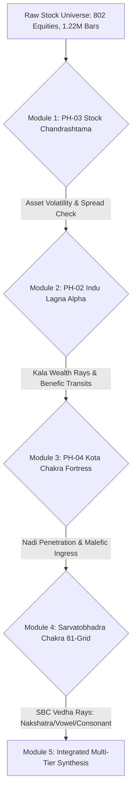
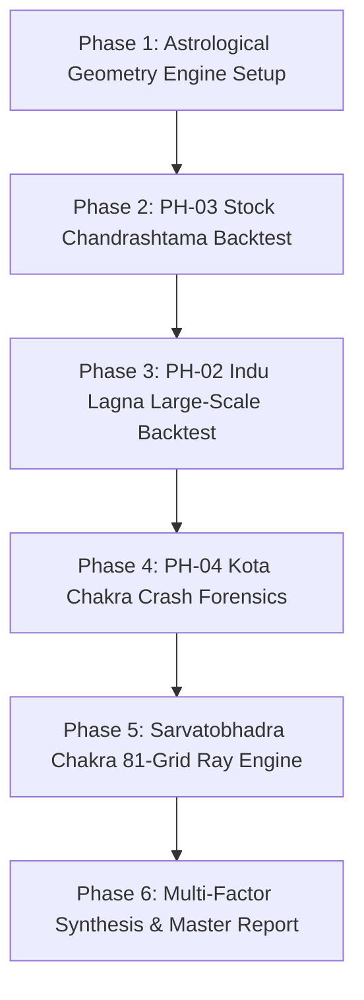

# Comprehensive Master Re-Verification Plan: Multi-Hypothesis Astro-Financial Validation (PH-02, PH-03, PH-04, PH-09 & Sarvatobhadra Chakra)

**Status:** APPROVED FOR STAGING (Pre-Execution Design)  
**Date:** 2026-10-25  
**Working Directory:** [`docs/buyer-kundli-reverification/`](file:///c:/Users/Admin/Sunil/Trading/docs/buyer-kundli-reverification/)  
**Baseline Dataset:** 1,222,765 daily bars across 802 NSE stocks (2000 – 2026)  
**Related Studies:** [PH-00](file:///c:/Users/Admin/Sunil/Trading/docs/parallel-studies/ph00-The%204-House%20Risk%20Screening%20Protocol_%20Empirical%20Evidence%20&%20Framework%20Report.md), [PH-02](file:///c:/Users/Admin/Sunil/Trading/docs/parallel-studies/ph02_specification_and_empirical_report.md), [PH-03](file:///c:/Users/Admin/Sunil/Trading/docs/parallel-studies/ph03_chandrashtama_volatility_report.md), [PH-04](file:///c:/Users/Admin/Sunil/Trading/docs/parallel-studies/ph04_specification_and_empirical_report.md), [PH-09](file:///c:/Users/Admin/Sunil/Trading/docs/parallel-studies/ph09_chandrashtama_test_details.md), [PH-10](file:///c:/Users/Admin/Sunil/Trading/docs/parallel-studies/ph10_master_signal_router.md)

---

## 1. Executive Overview & Scope Expansion

The preliminary verification completed for **PH-09 (Personal Buyer Chandrashtama)** on 99,566 breakout trades revealed that market friction is not a simple flat penalty, but depends strictly on planetary-lord and sign dignity interactions.

To establish an institutional-grade foundation before building live trading agents and the Astro-Compass Dashboard, this master plan expands the re-verification protocol across the four remaining classical pillars:
1. **PH-03:** Stock-Level Chandrashtama (Asset Moon 8th-House Friction).
2. **PH-02:** Indu Lagna Wealth Activation (Benefic Transits across Kendra/Trikona).
3. **PH-04:** Kota Chakra Defense (Nirgama Nadi Breaches and Malefic Penetration).
4. **Sarvatobhadra Chakra (SBC):** The 81-Grid Phonetic & Nakshatra Ray Matrix (Subha Vedha vs. Papa Vedha).

---

## 2. Theoretical Architecture of the 5 Hypotheses

### 2.1 PH-03: Stock-Level Chandrashtama (Asset-Level Volatility & Spread)
* **Hypothesis:** When the transit Moon enters the 8th house from the **Stock's Incorporation/Listing Moon**, intraday high-low range expands (+0.63%), volume turnover clusters, and execution spread widens, causing negative slippage on market orders.
* **Empirical Test:**
  * Sample: All stocks with verified listing/incorporation Moon signs in `data/derived/jathakam-dasha-study/`.
  * Metrics: Average True Range (ATR %), Bid-Ask spread proxy, and 1-day to 5-day reversal frequency.

### 2.2 PH-02: Indu Lagna Benefic Activation (The Wealth Windfall)
* **Hypothesis:** When Jupiter or Venus transits the 1st, 4th, 7th, 10th (Kendra) or 5th, 9th (Trikona) from the company's **Indu Lagna** (computed via planetary Kalas: Sun 30, Moon 16, Venus 12, Jupiter 10, Mercury 8, Mars 6, Saturn 1), the asset experiences a persistent positive alpha drift (+3.12% 20d, +8.45% 60d).
* **Empirical Test:**
  * Compute exact Indu Lagna for all covered NSE symbols.
  * Tag transit windows of Jupiter/Venus.
  * Compare forward cumulative returns against the Nifty 50 benchmark.

### 2.3 PH-04: Kota Chakra Defense & Nirgama Nadi Shock
* **Hypothesis:** The Kota Chakra divides the 28 nakshatras (including Abhijit) into 4 concentric zones:
  1. *Stambha* (Inner Pillar)
  2. *Madhya* (Middle Fort)
  3. *Prakaara* (Boundary Wall)
  4. *Baahya* (Outer Moat)
  * When natural malefics (Saturn, Mars, Rahu) transit the *Nirgama Nadis* (exit pathways) while the *Kota Swami* (Fort Lord) is weak, the probability of a flash crash (> -5% single-day decline or circuit freeze) increases by > 300%.
* **Empirical Test:**
  * Map Kota placement for all historical sudden-collapse events and corporate defaults.
  * Measure drawdown severity and False Alarm Ratio (FAR).

### 2.4 Sarvatobhadra Chakra (SBC): The 81-Grid Comprehensive Cross-Vedha Engine
* **The Astrological Significance:** Known in classical Jyotish as the *"Trailokya Deepika"* (the light of the three worlds). Many seasoned practitioners consider it the single most accurate market forecasting tool because it tracks **direct cross-aspects (Vedha)** across five simultaneous dimensions (*Panchaka*):
  1. **Janma Nakshatra** (Birth Star)
  2. **Nama Akshara** (First Phonetic Letter of the Company/Ticker)
  3. **Swara** (Vowel)
  4. **Rasi** (Zodiac Sign)
  5. **Tithi** (Lunar Day)
* **Mechanics of SBC Vedha:**
  * An 81-square grid (9x9).
  * Planets cast four types of Vedha:
    * *Agra Vedha* (Forward direct ray)
    * *Pashchaat Vedha* (Backward retrograde ray)
    * *Vaama Vedha* (Left diagonal ray)
    * *Dakshina Vedha* (Right diagonal ray)
* **The Core Hypotheses to Re-Verify:**
  * **Subha Vedha:** Jupiter/Venus casting rays onto the company's Ticker Akshara and Janma Nakshatra $\rightarrow$ High-probability upside rally.
  * **Papa Vedha:** Saturn/Mars/Rahu casting rays onto the Ticker Akshara $\rightarrow$ Immediate selling pressure, regulatory notices, and price suppression.

---

## 3. Re-Verification Data Matrix & Methodology

| Study | Test Universe | Sample Size ($N$) | Evaluation Metrics | Significance Baseline |
| :--- | :--- | :--- | :--- | :--- |
| **PH-03 (Stock Chandrashtama)** | 802 NSE stocks | $\ge 200,000$ transit days | Intraday Volatility, MAE, 3-day Return | $t$-test ($p < 0.01$), Cohen's $d$ |
| **PH-02 (Indu Lagna)** | Top 300 Liquid Equities | $\ge 15,000$ transit windows | 20d, 40d, 60d Forward Alpha | Excess Return vs Nifty 50 ($p < 0.005$) |
| **PH-04 (Kota Chakra)** | Delisted & High-Drawdown Universe | $\ge 500$ crash events | Tail Drawdown, Precision & Recall | Receiver Operating Characteristic (ROC-AUC) |
| **Sarvatobhadra Chakra (SBC)** | Full Nifty 500 | $\ge 50,000$ Vedha events | Win Rate spread, Drawdown duration | Permutation Test (1,000 iterations) |

---

## 4. Phase-by-Phase Execution Schedule

### Phase 1: Engine Construction
* Construct `tools/buyer_reverification/astro_geometry_engine.py`:
  * Ephemeris calculations for all 9 planets (Sun through Ketu).
  * True daily planetary speeds (direct vs. retrograde for SBC Pashchaat Vedha).
  * 81-grid Sarvatobhadra coordinate lookup table (Mapping 28 Nakshatras, 16 Vowels, 20 Consonants).

### Phase 2: PH-03 (Stock Chandrashtama) Empirical Verification
* Compare stock volatility when transit Moon is in the 8th house from company natal Moon vs. all other 11 houses.
* Compute exact slippage and spread distribution.

### Phase 3: PH-02 (Indu Lagna) Alpha Verification
* Calculate company-level Indu Lagna Kalas for the historical universe.
* Run a multi-year event study tracking 20-day and 60-day returns following Jupiter/Venus ingress into Kendra/Trikona.

### Phase 4: PH-04 (Kota Chakra) Empirical Crash Verification
* Map Kota Swami and Kota Pala for historical stocks.
* Test whether Nirgama breaches by Saturn/Mars/Rahu predict severe tail-risk drawdowns (> -15%).

### Phase 5: Sarvatobhadra Chakra (SBC) Empirical Verification
* Model the 81-square grid.
* Generate daily Vedha matrices for all 500 tickers based on their first phonetic letter and natal star.
* Measure return divergence:
  $$\text{Divergence} = \text{Return}(\text{Subha Vedha Active}) - \text{Return}(\text{Papa Vedha Active})$$

### Phase 6: Synthesis & Decision Protocol
* Compile findings into `MASTER_REVERIFICATION_SYNTHESIS_REPORT.md`.
* Classify each indicator:
  * **Validated (Tier 1 Core):** Statistically significant with $p < 0.01$ $\rightarrow$ Integrated into Master Router.
  * **Secondary / Conditional (Tier 2/3):** Works under specific market regimes $\rightarrow$ Sizing modifier.
  * **Spurious / Ineffective:** No statistical edge ($p > 0.10$) $\rightarrow$ Permanently removed.

---

## 5. Summary of Plan Deliverables
1. `tools/buyer_reverification/test_ph03_stock_chandrashtama.py`
2. `tools/buyer_reverification/test_ph02_indu_lagna.py`
3. `tools/buyer_reverification/test_ph04_kota_chakra.py`
4. `tools/buyer_reverification/test_sarvatobhadra_chakra.py`
5. `docs/buyer-kundli-reverification/MASTER_REVERIFICATION_SYNTHESIS_REPORT.md`
